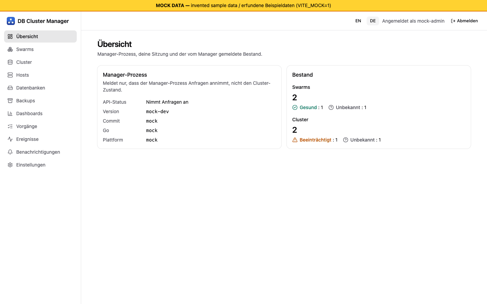

# Erste Schritte und Installation

[Übersicht](index.md) | Weiter: [Hosts und Agenten einbinden](02-hosts-and-agents.md)

## Was Sie heute bekommen

Der Manager ist ein einzelnes Go-Programm, das die Web-Oberfläche und die HTTP-API (`/api/v1`) ausliefert. Er läuft in drei Betriebsarten:

| Betriebsart | Was funktioniert | Stufe |
| --- | --- | --- |
| Prototyp (ohne `-config`) | Oberfläche, `GET /api/v1/health`, `GET /api/v1/version`. Kein Zustand, kein Docker. | Auf dem Entwicklungsrechner über Loopback ausgeliefert (W02); kein Container- oder VM-Lauf. |
| Auth-Modus (`auth.enabled`, ohne `manager`-Abschnitt) | Einrichtung, Passkey-Anmeldung, Wiederherstellung, Rollen, Audit ins Log. Zustand **nur im Speicher**, beim Neustart weg; Ressourcen-Endpunkte antworten 503. | [Fakes] (Software-Authenticator) |
| Verwalteter Modus (`manager`-Abschnitt) | Replizierter Speicher, Swarm-Anbindung, Agenten-Deployment, Cluster-Operationen, Backups, Monitoring. | [Lab-VMs] als Einzelinstanz, als Prozess auf einem Swarm-Manager-Knoten (E4-E6). |

*Bildschirmfoto aus dem Entwicklungs-Mock-Server (`npm run dev:mock`, erfundene Beispieldaten), nicht von einem echten Manager.*

## Voraussetzungen

- Ein Docker Swarm (E4-E6: Docker 29.9.2 auf Ubuntu 26.04, arm64). Die Kompatibilitätsmatrix kennt nur Docker 29.x. Für amd64 gibt es **keinen** Nachweis [Ungetestet].
- Ein TLS-Reverse-Proxy vor dem Manager. Passkeys (WebAuthn) brauchen einen HTTPS-Origin, dessen Host der konfigurierte `rpId` ist; reines `http://localhost` gilt nur für die Entwicklung. Der Manager hat für Oberfläche und API kein eigenes TLS.
- `/var/run/docker.sock` **nicht** in den Manager-Container einbinden (Root auf dem Host). Der Container aus `deploy/` läuft als uid 65532 und könnte den Socket ohnehin nicht nutzen.

## Manager installieren

Technische Details und Paketierungsstand: [INSTALL.md](../../INSTALL.md) (englisch). Kurzfassung:

1. Image beschaffen. Es gibt noch kein Release; lokal aus dem Repository-Wurzelverzeichnis bauen (dedizierte Testumgebung und expliziter Docker-Kontext): `docker buildx build -f deploy/Dockerfile -t db-cluster-manager:local --build-arg VERSION=0.0.0-dev --load .` Das Image wurde vom Projekt **nie gebaut** [Ungetestet]; Labor E4 baute die entsprechende Laufzeit-Stufe in einer VM.
2. Einzelinstanz: `DBCM_IMAGE=db-cluster-manager:local docker compose -f deploy/compose.yaml up -d`, dann `curl http://127.0.0.1:8080/api/v1/health`. Das startet nur den **Prototyp-Modus**, weil die mitgelieferte Compose-Datei keine Konfiguration übergibt [Ungetestet].
3. Für den verwalteten Modus braucht der Manager eine JSON-Konfiguration (`-config <Datei>` oder Umgebungsvariable `DCM_CONFIG`) mit einem `auth`-Abschnitt (`enabled`, `rpId`, `rpDisplayName`, `origins`) und einem `manager`-Abschnitt (Knoten-ID, Datenverzeichnis, Bind-Adresse, Agententransport, Einstellungen, Backup-Ziel). Die Felder stehen im Kopfkommentar von `cmd/manager/main.go`; unbekannte Felder werden abgelehnt. Eine Konfigurationsreferenz als Benutzerdokument fehlt noch. E4 betrieb den Manager als transiente systemd-Unit auf einem Swarm-Manager-Knoten mit dem lokalen Docker-Socket, nicht als Container.

### Swarm-Stack

`deploy/stack.yaml` startet drei Replikate. Das sind drei **unabhängige** Instanzen, kein hochverfügbarer Manager: Das Image enthält keine Peer-Konfiguration, und Swarm-Replikate haben keine stabilen Identitäten. Nur zum Test der Paketierung nutzen [Ungetestet]. Ein replizierter Metastore mit mehreren Manager-Replikaten wurde nur als Labor-Werkzeug `metad` (E3) und als Bibliothekscode nachgewiesen; ein Multi-Replika-Manager lief nicht auf VMs.

## Erster Start: Einrichtungstoken und erster Passkey

1. Manager mit aktivierter Authentifizierung starten. Beim Start erscheint eine Zeile auf stderr (Container: `docker logs`): `First-run setup token (valid until the first administrator is created): <Token>`. Im verwalteten Modus wird das Token nur ausgegeben, solange es keinen Administrator gibt.
2. Oberfläche über Ihre HTTPS-URL öffnen. Die Einrichtungsseite fragt nach Token, Konto-ID und Passkey-Bezeichnung und startet die Passkey-Registrierung des Browsers.
3. Danach existiert der erste Administrator, die Einrichtung ist dauerhaft gesperrt, eine Sitzung beginnt, und **zehn Wiederherstellungscodes werden genau einmal angezeigt**. Bewahren Sie sie offline auf (Passwortmanager oder Ausdruck). Es werden nur Hashes gespeichert.
4. Später melden Sie sich mit dem Passkey an. Weitere Passkeys lassen sich über das Konto registrieren (`/auth/passkeys/*`).

Prüfstand: Der API-Ablauf lief auf Lab-VMs mit einem ES256-Software-Authenticator (Konto angelegt, 10 Codes, Sitzung, `setupRequired: false`) [Lab-VMs]. Der UI-Ablauf lief einmal in headless Chromium mit virtuellem Authenticator [Fakes]. Ein echter Hardware-Authenticator, ein Plattform-Passkey, Safari/Firefox und Screenreader wurden **nicht** getestet [Ungetestet]. Falsche Einrichtungstokens werden je Client-IP begrenzt.

Token verloren: Manager neu starten (solange kein Administrator existiert, wird ein neues Token ausgegeben). Alle Passkeys verloren: siehe [Sicherheitsmodell](08-security-model.md).

## Nächste Schritte

Swarm anbinden und Hosts einbinden: [Hosts und Agenten einbinden](02-hosts-and-agents.md). Lesen Sie vor jedem Vertrauen [Bekannte Grenzen](10-known-limits.md).
