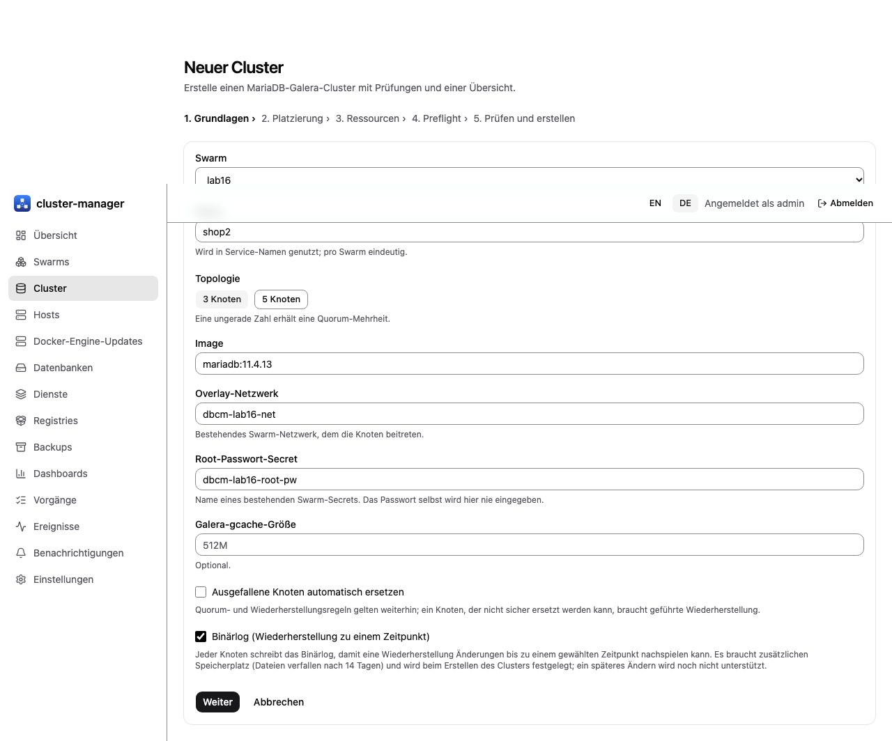
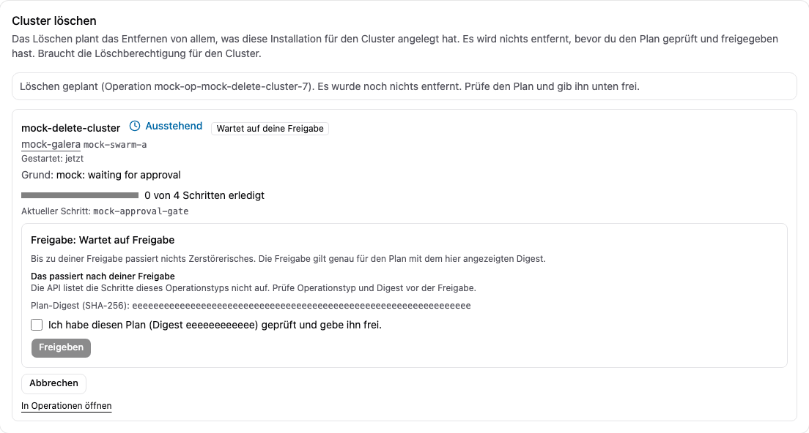

# Galera-Cluster anlegen

[Übersicht](index.md) | Zurück: [Hosts einbinden](02-hosts-and-agents.md) | Weiter: [Zustand und Alarme](04-health-alerts.md)

## Anfrage

`POST /api/v1/clusters` (oder der Cluster-Assistent der Oberfläche). Pflichtfelder: `swarm`, `name` (Kleinbuchstaben, Ziffern, Bindestriche, höchstens 48 Zeichen), `size` (**3 oder 5**), `image` (MariaDB-Image; ein Tag wie `mariadb:11.4.13` funktioniert, über einen Test hinaus wird ein Digest empfohlen; das Image muss auf jedem Knoten vorhanden sein), `network` (vorhandenes anhängbares Overlay), `rootPasswordSecret` (Name eines vorhandenen Swarm-Secrets, nie das Passwort), `resources.limits` und `resources.reservations` sowie `placement` (Positivliste, Ausschluss, Präferenz, `reserve`). Optional: `gcacheSize`, `autoReplace`, `binlog` (das Kontrollkästchen „Binärlog (Wiederherstellung zu einem Zeitpunkt)“: jeder Knoten schreibt das Binärlog; es lässt sich später nicht einschalten und ist Voraussetzung für die [Wiederherstellung zu einem Zeitpunkt](05-backup-restore.md)). Der Schritt „Ressourcen“ des Assistenten verlangt ein CPU- und ein Speicherlimit oder eine Reservierung; ohne sie stoppt die Vorabprüfung. Ein Drei-Knoten-Cluster mit Binärlog, 1 CPU / 1 GiB je Knoten, erreichte auf Labor-VMs mit 2 vCPU / 4 GiB in etwa zwei Minuten 23 von 23 Schritten [Lab-VMs, E16].

Vorrang bei der Platzierung: Positivliste, Ausschluss, Präferenz, dann automatische Bewertung; derselbe Host in Positivliste und Ausschluss ergibt `policy_conflict`. Weitere grobe Fehler: `no_capacity`, `settings_incomplete`, `cluster_exists`. Die Antwort ist eine Operation (`202`); verfolgen Sie sie mit `GET /api/v1/operations` (der Fortschritt zeigt aktuellen Schritt, Versuche und die letzte ungeklärte Vorbedingung).

*Echter Screenshot der deutschen Oberfläche: Manager auf Lab-VMs (E16, 2026-10-31).*

## Was die Operation tut

Ein festgelegter Swarm-Dienst je Knoten, jeweils mit eigenem lokalem Volume und Identitätsmarker; der Bootstrap-Knoten startet zuerst, die übrigen treten nacheinander bei; Monitoring-Konto (`dbcm_monitor`) und Backup-Konto (`dbcm_backup`) werden angelegt und repliziert. Ein Knoten startet nie auf einem leeren Volume ohne Marker (Schutz vor der „Leeres-Volume-Falle“ aus E2).

## Prüfstand

| Teil | Stufe |
| --- | --- |
| 3-Knoten-MariaDB-11.4-Cluster über die Manager-API: Operation `succeeded` nach etwa 80 s, alle Knoten `Synced`, Größe 3, gleiche State-UUID, Schreibzugriffe auf n1/n3 überall lesbar, SST per mariabackup über den verlegten Socket | [Lab-VMs] (E4, einmal von Grund auf; Host unter Fremdlast, Zeiten nur bedingt belastbar) |
| Festgelegte Dienste, Hostverlust und Rückkehr, Minderheitspartition, Markerschutz | [Lab-VMs] (E1/E2, Skripte, nicht über den Manager) |
| 5-Knoten-Cluster | [Ungetestet] |
| Kapazitätsplanung, `no_capacity`, Ressourcenerschöpfung | [Fakes] |
| Assistent in der Oberfläche | [Fakes] (Headless-Browser, Fake-API) |
| amd64 | [Ungetestet] |

## Fehlgeschlagene Erstellung und Löschen

Eine abgebrochene Erstellung (`POST /api/v1/operations/{id}/abort`) endet im Zustand `aborted`; ihr Grund beginnt mit `aborted at a safe boundary` und nennt Schritte mit unbekanntem Ergebnis. Eine fehlgeschlagene oder abgebrochene Erstellung behält Clustername und geplante Kapazität, bis Sie den Cluster löschen. `DELETE /api/v1/clusters/{id}` plant eine `cluster/delete`-Operation und liefert einen Freigabe-Digest; vor `POST /api/v1/operations/{id}/approve` mit diesem Digest wird nichts entfernt. Nötig ist die Berechtigung **Löschen** (nur Administrator-Preset). Entfernt werden nur Objekte, die die Installation angelegt hat (Datenbankdienste, unfertige Job-Dienste, Inspektionsinstanzen, Knoten-Volumes nach der Identitätsprüfung). Netzwerke und Secrets des Betreibers, Host-Verzeichnisse lokaler Volumes und Backups im Ziel bleiben erhalten. Dieser Pfad lief nur gegen Fakes [Fakes]; die Bereinigung der fehlgeschlagenen Erstellung in E4 geschah von Hand.

*Bildschirmfoto aus dem Entwicklungs-Mock-Server (`npm run dev:mock`, erfundene Beispieldaten), nicht von einem echten Manager.*

## Nach der Erstellung

- Endpunkte erscheinen als `<Cluster>-nN:3306` im Overlay-Netzwerk. Ein Endpunkt für Clients braucht den Datenbank-Proxy, den der Manager noch nicht bereitstellt; siehe [Bekannte Grenzen](10-known-limits.md). Das Programm `cmd/proxy` lief vor dem Laborcluster (Schreibknoten-Wahl, Failover, TLS-Terminierung) [Lab-VMs] (E5), von Hand als Labor-Container gestartet.
- Verwaltung von Datenbanken, Benutzern und Rechten existiert nur als SQL-Erzeugung [Fakes].
