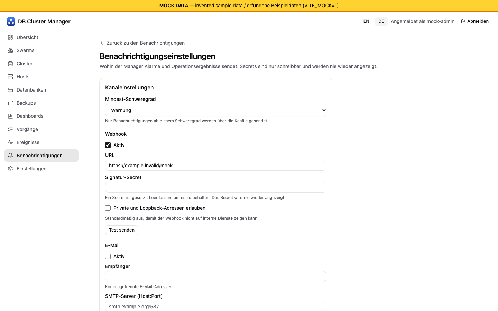

# Zustand und Alarme

[Übersicht](index.md) | Zurück: [Cluster anlegen](03-create-cluster.md) | Weiter: [Backups und Wiederherstellung](05-backup-restore.md)

## Zustand

Ein nur auf dem Leader laufender Sammler fragt über den Agenten jedes Knotens den Galera-Status ab (`collect-health`), mit dem Monitoring-Konto über den Knoten-Socket. `GET /api/v1/clusters/{id}` zeigt den Cluster als `healthy` oder `degraded` und jeden Knoten mit Zustand (`synced`, `donor`, `unavailable` usw.). Fehlende Werte bedeuten unbekannt, nicht null.

Beobachtet nach `docker kill` eines Containers: nach 10 s `degraded` und Knoten `unavailable`, Donor `n1` während der Zustandsübertragung, nach 40 s alles `healthy/synced` (Swarm startete den Task neu) [Lab-VMs] (E4).

## Ereignisse und Benachrichtigungen

- Wird ein Knoten ungesund oder wieder gesund, entsteht je Übergang einmal ein Ereignis und eine UI-Benachrichtigung (unterdrückt, solange der Cluster gelöscht wird). [Fakes]: nach E4 ergänzt und **nicht** erneut auf VMs gelaufen; in E4 selbst gab es kein Ereignis für den Ausfall.
- Für einen Totalausfall gibt es **noch kein** Ereignis und keine Benachrichtigung.
- Kanäle: Oberfläche, Webhook (SSRF-geschützt) und E-Mail, konfiguriert über `GET/PUT /api/v1/settings/notifications` (Secrets nur schreibbar, verschlüsselt gespeichert). `POST /api/v1/settings/notifications/test` sendet ein Testereignis. Ein echter Webhook-Empfänger oder SMTP-Server wurde **nicht** getestet [Fakes]. Quittieren und Gelesen-Markierung: `POST /api/v1/notifications/{id}/ack` und `/read`.

*Bildschirmfoto aus dem Entwicklungs-Mock-Server (`npm run dev:mock`, erfundene Beispieldaten), nicht von einem echten Manager.*

## Alarmregeln und Metriken

Es gibt vorgeschlagene Standardregeln: Galera-Größendefizit (1 min), keine Primary-Komponente (30 s), Flow Control über 0,1 für 2 min, Host-Datenträger über 90 %, Backup-Alter über Plan, Zertifikatsablauf unter 14 und 3 Tagen, Ziel nicht erreichbar, Proxy ohne Schreibknoten. Jede Regel hat Schweregrad und Wiederholsperre. Nur [Fakes]: Engine, eigener Zeitreihenspeicher und Dashboard-API sind unit-getestet; die Sammler für viele dieser Reihen sind nicht an echte Hosts angeschlossen, daher können mehrere Regeln in einer echten Installation noch nicht auslösen. Aufbewahrungsgrenzen und ein Langzeitarchiv auf S3/SFTP sind Bibliothekscode [Fakes].

Dashboards (`/api/v1/dashboards`, `/api/v1/metrics/query`) zeigen SVG-Diagramme in der Oberfläche. Einmal in headless Chromium gegen Fakes dargestellt [Fakes].

## Umgang mit Alarmen

Bei einem degradierten Cluster siehe [Fehlersuche](09-troubleshooting.md). Ersetzen Sie keine Knoten, solange das Quorum unklar ist: siehe [Knotenersatz](06-node-replacement.md).
