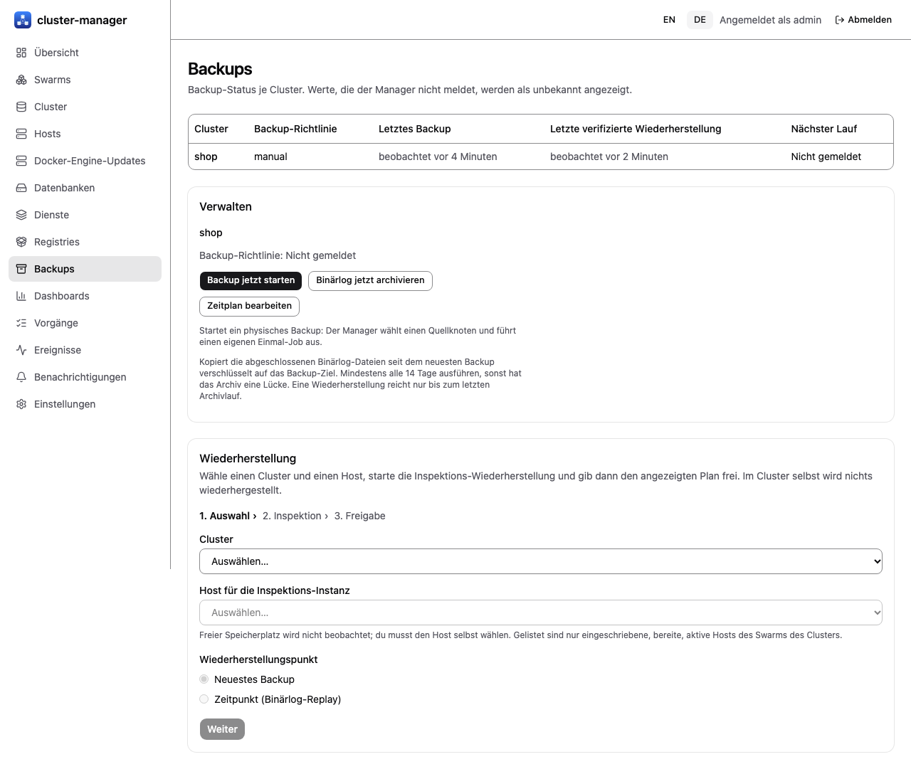
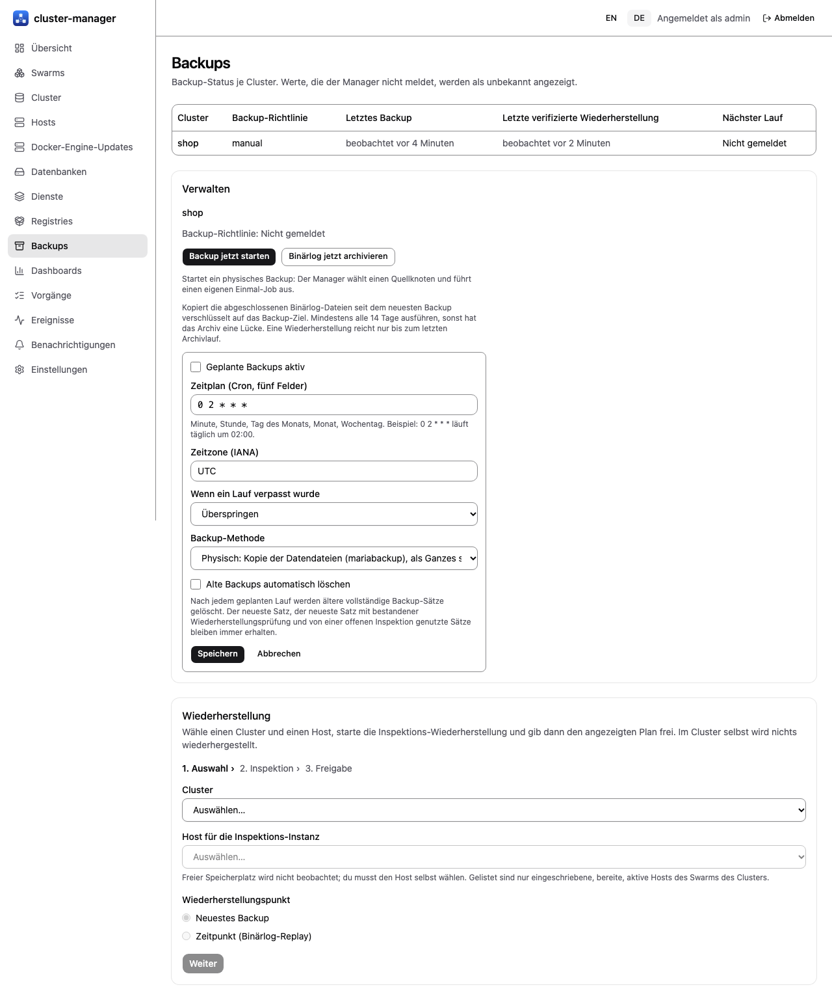
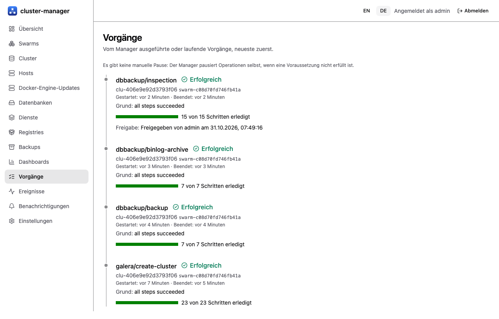

# Backups und Wiederherstellung

[Übersicht](index.md) | Zurück: [Zustand und Alarme](04-health-alerts.md) | Weiter: [Knotenersatz](06-node-replacement.md)

## Begriffe

- **Cluster-Backup:** ein physisches Backup (`mariabackup`), verschlüsselt gestreamt auf ein S3- oder SFTP-Ziel durch einen einmaligen Swarm-Job-Dienst (Job-Image `deploy/Dockerfile.jobs`, `mariadb:11.4.13` plus `dbcm-job`). Ein **logisches** Backup (ein `mariadb-dump`-Export je benannter Datenbank) ist als Methode verfügbar; es braucht `accounts.backupLogical` in den Einstellungen, damit das Backup-Konto die nötigen Leserechte hat.
- **Backup der Manager-Konfiguration** ist ein separates Bibliotheksmerkmal (siehe unten).
- **Inspektions-Wiederherstellung:** Das Backup wird in eine isolierte Einzelknoten-Instanz zurückgespielt (`--wsrep-on=OFF`, eigenes Netzwerk, eigener Port, keine Replikation, kein Binlog), damit Sie die Daten ansehen können. Sie tritt nie dem Produktivcluster bei.

## Voraussetzungen

Ziel-Einstellungen (`manager.backup.backendConfigFile`), ein Recovery-Key-Swarm-Secret, ein Secret mit der Backup-Optionsdatei, das Job-Image auf den betroffenen Knoten und ein Inspektionsnetzwerk. Das Labor nutzte SFTP mit eigenem Benutzer und festgelegtem Host-Key. Das `dir`-Ziel funktioniert mit Jobs nicht (der Job schreibt in seinen eigenen Container).

## Backup starten und Zeitplan setzen

- Sofort: `POST /api/v1/clusters/{id}/backups` (Berechtigung Backup auf dem Cluster). Der Manager wählt einen geeigneten Quellknoten und legt einen eigenen, an diesen Host gebundenen Job an.
- Zeitplan: `PUT /api/v1/clusters/{id}/backup-policy` mit `enabled`, einem fünfstelligen Cron-ähnlichen `schedule`, `timezone`, `missed` (`skip` oder `run-once`) und `method: physical` oder `logical` (logisch braucht `databases`, höchstens 64) sowie optional `retention` mit `keepLast` (1-1000), `keepDaily` und `keepWeekly`. Ein manuelles logisches Backup ist `POST /api/v1/clusters/{id}/backups` mit `{"method": "logical", "databases": ["app"]}`. `GET /api/v1/backups` liefert `lastBackupAt`, `nextRunAt`, `lastVerifiedRestoreAt`; fehlend heißt unbekannt, nicht „keines“.

*Echter Screenshot der deutschen Oberfläche: Manager auf Lab-VMs (E16, 2026-10-31).*

## Aufbewahrung

Nach jedem Durchlauf des Zeitplaners löscht der Manager ältere vollständige Backup-Sätze gemäß der Richtlinie (zuerst das Manifest, dann den Stream). Er behält stets den neuesten Satz, den neuesten Satz mit bestandener Wiederherstellungsprüfung und Sätze einer offenen Inspektion und überspringt einen Cluster, solange eine seiner Operationen unfertig ist. [Fakes]: ein Ende-zu-Ende-Test über vier simulierte Tage mit Fake-Jobs und einem Speicher-Backend; es lief kein Löschen gegen ein echtes SFTP- oder S3-Ziel.

Im Zeitplanformular wählt man die Methode (physisch oder logisch mit den zu exportierenden Datenbanken) und optional die Aufbewahrung (die letzten N Sätze, einen pro Tag für N Tage, einen pro Woche für N Wochen). Das Formular nennt, dass der neueste Satz, der neueste geprüfte Satz und von einer offenen Inspektion genutzte Sätze immer bleiben.

*Echter Screenshot der deutschen Oberfläche: Manager auf Lab-VMs (E16, 2026-10-31).*

Die Aufnahme zeigt das Formular gegen einen echten Manager; der Zeitplan wurde dabei nicht gespeichert.

## Wiederherstellung per Inspektion mit Freigabe

1. `POST /api/v1/restores/inspect` mit `cluster`, optional `backup` (Standard: neuestes abgeschlossenes), `host`, `keySecret`, `ttlMinutes` (höchstens 1440). Die Antwort enthält den **Freigabe-Digest** und, nur einmal, das Passwort des Inspektionskontos.
2. Plan prüfen, dann `POST /api/v1/operations/{id}/approve` mit dem Digest. Ein falscher Digest ergibt `409 approval_mismatch`. Die Freigabe erfordert die Berechtigung **Wiederherstellen** (Administratoren; nicht im Operator-Preset).
3. Der Job stellt wieder her, die Instanz startet, Sie verbinden sich mit dem einmaligen Konto `dbcm_inspect`. Bei Ablauf werden Instanz, Volume und Init-Secret entfernt.

*Echter Screenshot der deutschen Oberfläche: Manager auf Lab-VMs (E16, 2026-10-31).*

## Prüfstufen

| Teil | Stufe |
| --- | --- |
| Physisches Backup nach SFTP mit Quelle auf einem Worker (etwa 15 s, 55,7 MB Stream, Manifest mit Checkpoints) | [Lab-VMs] (E4) |
| Inspektions-Wiederherstellung mit Freigabe-Digest, falscher Digest `409`, wiederhergestellte Zeilen lesbar, `wsrep_on 0` | [Lab-VMs] (E4, auf dem Host des Manager-Knotens) |
| Restore- und Inspektionsjobs auf Worker-Hosts (Job über den Agenten des Manager-Knotens, Prüfung des Zielhosts) | [Fakes] |
| Verifikationstor, Bericht auf Instanzebene, `lastVerifiedRestoreAt`, Abbau mit Secret-Entfernung | [Fakes]; Tabelleninhalte werden auch im Entwurf nicht verglichen |
| Galera-Position im Manifest aus dem Stream gelesen | [Fakes]; unbestätigte Annahme für MariaDB 11.4 |
| Backup-Zeitplaner, logisches Backup (manuell und geplant), Aufbewahrung, S3-Ziel, Wiederherstellung in einen **neuen Cluster** | [Fakes] |
| PITR (Archiv-Job, Wiedergabe, API, UI) | [Lab-VMs] (E16): echter Manager, Agents und UI, ein Backup, ein Archivlauf, eine Zeit T, Zeilen-/Prüfsummenvergleich; Archiv-Zeitplan in der Richtlinie [Fakes]; der Job-Helfer allein in E15 |
| Datenschlüsselrotation und Neuverschlüsselung | Nur [Fakes] |
| Selektive Wiederherstellung über die Manager-API | [Ungetestet] (nicht integriert) |
| Vollständige Wiederherstellung produktionsgroßer Daten, Wiederherstellungsdauer | [Ungetestet] |

Ein Backup gilt erst als gut, wenn eine Wiederherstellung getestet wurde. Bis zu einer geprüften Wiederherstellung Ihrer Daten behandeln Sie das Backup als ungeprüft. Manifestformat 2 ([ADR-0009-Ergänzung](../../decisions/0009-cluster-backup-method.md)) speichert Chunk- und Klartext-Digests als HMACs mit einem aus dem Datenschlüssel des Streams abgeleiteten Schlüssel, sodass das Manifest keine Klartext-Hashes mehr verrät [Fakes]; Manifeste im Format 1 bleiben wiederherstellbar und geprüft. Die Lab-Backups aus E4 sind älter als Format 2 und haben Format 1 [auf VMs ungetestet].

## Kopien, geplante Prüfung und das Backup des Managers selbst

Backups lassen sich mit signierten, geprüften Transfer-Records auf andere Ziele kopieren (Speicher eines anderen Clusters oder Swarms), aus einer Kopie nur über einen ausdrücklichen, per Digest freigegebenen Vorschlag in einen neuen Cluster wiederherstellen, nach Zeitplan prüfen (mit Benachrichtigung bei Fehlschlag), und das Metastore des Managers lässt sich sichern und offline wiederherstellen. Ziele können lokal, S3-kompatibel oder SFTP sein, optional mit clientseitiger Verschlüsselung. Alles steht in [Notfallwiederherstellung und Backup-Kopien](21-disaster-recovery.md) [Fakes].

Die ältere Bibliothek `internal/backup` (verschlüsselte Konfigurations-Snapshots mit Wiederherstellung im Inspektionsmodus) wird von der API nicht aufgerufen; das Metastore-Backup übernimmt ihre Rolle für die Notfallwiederherstellung.

## Wiederherstellung zu einem Zeitpunkt (PITR) [Lab-VMs, E16; Archiv-Zeitplan Fakes]

PITR stellt einen Cluster auf eine gewählte Sekunde wieder her, nicht nur auf den Zeitpunkt eines Backups. Dafür braucht es drei Dinge ([ADR 0031](../../decisions/0031-point-in-time-recovery.md)):

1. **Binärlog an.** Cluster mit `binlog: true` erstellen (Kontrollkästchen „Binärlog“ im Erstellformular). Jeder Knoten schreibt dann das Binärlog (zusätzlicher Speicherplatz; Dateien verfallen nach 14 Tagen). Bestehende Cluster lassen sich noch nicht umstellen.
2. **Vollbackup, danach Archivläufe.** Nach einem Backup kopiert „Binärlog jetzt archivieren“ (`POST /api/v1/clusters/{id}/binlog-archives`, Backup-Recht) die abgeschlossenen Binärlog-Dateien des Quellknotens dieses Backups verschlüsselt auf das Backup-Ziel. Eine Wiederherstellung reicht nur bis zum letzten Archivlauf; führen Sie ihn regelmäßig aus (von Hand oder mit dem Archiv-Zeitplan der Backup-Richtlinie: im Zeitplanformular „Binärlog nach Zeitplan archivieren“ ankreuzen, `archive` in `PUT /clusters/{id}/backup-policy`) [Fakes], mindestens alle 14 Tage, sonst hat das Archiv eine Lücke und der Job scheitert mit der Begründung. Wurde der Quellknoten ersetzt, ist ein neues Vollbackup nötig.
3. **Wiederherstellung in eine neue Instanz.** Im Wiederherstellungs-Assistenten „Zeitpunkt“ wählen, die Zeit in **UTC** eintragen und „Abdeckung prüfen“ drücken (`GET /api/v1/clusters/{id}/pitr-proposal?at=...`, nur lesend). Die Antwort nennt das Ausgangs-Backup und die Zahl der Dateien, oder warum die Zeit nicht abgedeckt ist (kein Binärlog beim Backup, fehlende Datei, geänderte Historie, Zeit nach dem letzten archivierten Ereignis, Zeit vor dem ersten Backup). Nur eine abgedeckte Zeit lässt sich wiederherstellen. Die Wiederherstellung (`POST /api/v1/restores/inspect` mit `pointInTime`) läuft wie die Inspektions-Wiederherstellung: neue isolierte Instanz, Plan mit Digest, **Ihre Freigabe**, gleiche Ablaufzeit und gleicher Abbau. Sie spielt alle Änderungen bis einschließlich der gewählten Sekunde ein. Der Produktiv-Cluster wird nie verändert; eine Wiederherstellung an Ort und Stelle gibt es nicht.

**Ablauf in der Oberfläche** (E16, echter Manager auf Lab-VMs, [Ergebnisse](../../../tests/p0/results/e16-install-walkthrough.md)): (1) Seite Backups, „Backup jetzt starten“; (2) Daten schreiben, UTC-Zeit T notieren, weiter schreiben; (3) „Binärlog jetzt archivieren“ (der Lauf schließt die offene Binärlog-Datei, eine Zeit T vor dem Lauf ist damit abgedeckt); (4) Wiederherstellungs-Assistent: Cluster, Host für die Inspektions-Instanz, „Zeitpunkt“, T als `JJJJ-MM-TTTHH:MM:SS` in UTC, „Abdeckung prüfen“ („Dieser Zeitpunkt lässt sich wiederherstellen“, Ausgangs-Backup, Zahl der Dateien); (5) „Weiter“, Bestätigung ankreuzen, „Inspektion starten“ und das Einmalpasswort sichern; (6) den Plan auf der Karte freigeben (Plan geprüft ankreuzen, „Freigeben“); die Wiederherstellung dauerte etwa 40 s; (7) auf dem Host der Instanz verbinden: `docker exec -i <Container von dbcm-inspect-...> mariadb -udbcm_inspect -p<Passwort> -S /dbcm/run/mysqld.sock` und vergleichen. Die wiederhergestellte Tabelle stimmte in Zeilenzahl, Summen und `CHECKSUM TABLE` mit dem Stand des Clusters zu T überein und enthielt die späteren Schreibvorgänge nicht [Lab-VMs].

Grenzen: ein Quellknoten je Backup (keine GTID-Fortsetzung über Knoten), Ereignisse sind sekundengenau, und eine Zeit in der letzten, noch offenen Binärlog-Datei ist erst nach dem nächsten Archivlauf abgedeckt. Der Weg über Manager, Agent und UI lief einmal auf Lab-VMs (E16, eine Archivdatei, eine Zeit); mehrere Dateien, Lücken, Knotenersatz, Last und Zeiten in Produktionsgröße liefen nicht. Der Job-Helfer allein: E15, [Ergebnisse](../../../tests/p0/results/e15-pitr.md).
