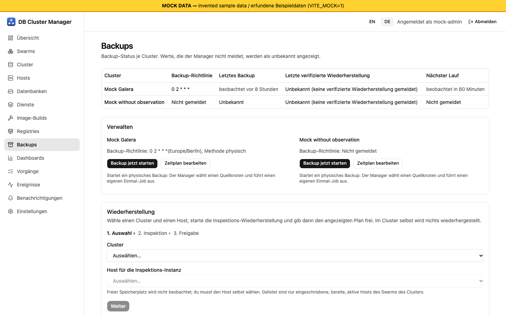
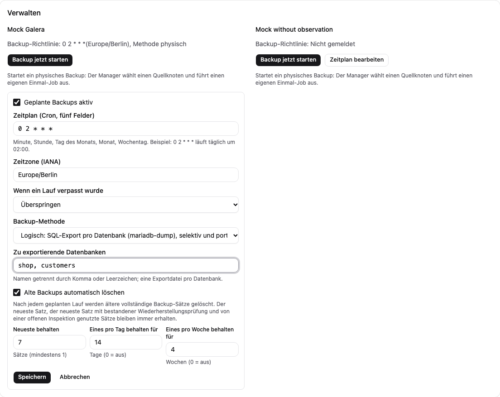
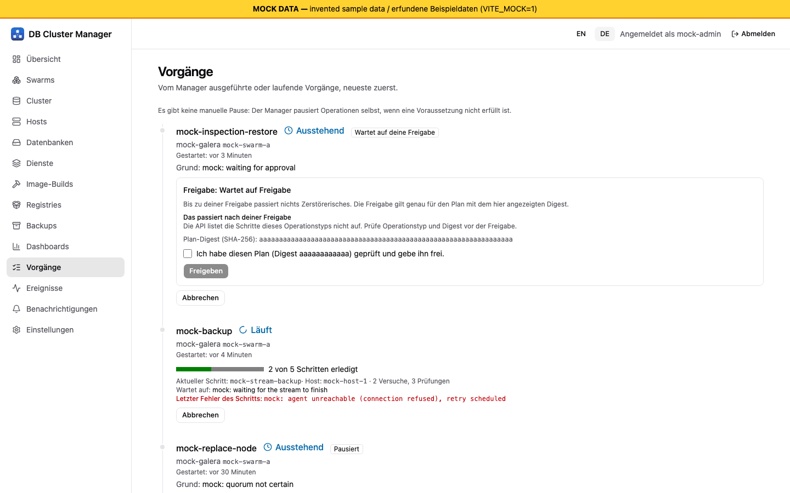

# Backups und Wiederherstellung

[Übersicht](index.md) | Zurück: [Zustand und Alarme](04-health-alerts.md) | Weiter: [Knotenersatz](06-node-replacement.md)

## Begriffe

- **Cluster-Backup:** ein physisches Backup (`mariabackup`), verschlüsselt gestreamt auf ein S3- oder SFTP-Ziel durch einen einmaligen Swarm-Job-Dienst (Job-Image `deploy/Dockerfile.jobs`, `mariadb:11.4.13` plus `dbcm-job`). Ein **logisches** Backup (ein `mariadb-dump`-Export je benannter Datenbank) ist als Methode verfügbar; es braucht `accounts.backupLogical` in den Einstellungen, damit das Backup-Konto die nötigen Leserechte hat.
- **Backup der Manager-Konfiguration** ist ein separates Bibliotheksmerkmal (siehe unten).
- **Inspektions-Wiederherstellung:** Das Backup wird in eine isolierte Einzelknoten-Instanz zurückgespielt (`--wsrep-on=OFF`, eigenes Netzwerk, eigener Port, keine Replikation, kein Binlog), damit Sie die Daten ansehen können. Sie tritt nie dem Produktivcluster bei.

## Voraussetzungen

Ziel-Einstellungen (`manager.backup.backendConfigFile`), ein Recovery-Key-Swarm-Secret, ein Secret mit der Backup-Optionsdatei, das Job-Image auf den betroffenen Knoten und ein Inspektionsnetzwerk. Das Labor nutzte SFTP mit eigenem Benutzer und festgelegtem Host-Key. Das `dir`-Ziel funktioniert mit Jobs nicht (der Job schreibt in seinen eigenen Container).

## Backup starten und Zeitplan setzen

- Sofort: `POST /api/v1/clusters/{id}/backups` (Berechtigung Backup auf dem Cluster). Der Manager wählt einen geeigneten Quellknoten und legt einen eigenen, an diesen Host gebundenen Job an.
- Zeitplan: `PUT /api/v1/clusters/{id}/backup-policy` mit `enabled`, einem fünfstelligen Cron-ähnlichen `schedule`, `timezone`, `missed` (`skip` oder `run-once`) und `method: physical` oder `logical` (logisch braucht `databases`, höchstens 64) sowie optional `retention` mit `keepLast` (1-1000), `keepDaily` und `keepWeekly`. Ein manuelles logisches Backup ist `POST /api/v1/clusters/{id}/backups` mit `{"method": "logical", "databases": ["app"]}`. `GET /api/v1/backups` liefert `lastBackupAt`, `nextRunAt`, `lastVerifiedRestoreAt`; fehlend heißt unbekannt, nicht „keines“.

*Bildschirmfoto aus dem Entwicklungs-Mock-Server (`npm run dev:mock`, erfundene Beispieldaten), nicht von einem echten Manager.*

## Aufbewahrung

Nach jedem Durchlauf des Zeitplaners löscht der Manager ältere vollständige Backup-Sätze gemäß der Richtlinie (zuerst das Manifest, dann den Stream). Er behält stets den neuesten Satz, den neuesten Satz mit bestandener Wiederherstellungsprüfung und Sätze einer offenen Inspektion und überspringt einen Cluster, solange eine seiner Operationen unfertig ist. [Fakes]: ein Ende-zu-Ende-Test über vier simulierte Tage mit Fake-Jobs und einem Speicher-Backend; es lief kein Löschen gegen ein echtes SFTP- oder S3-Ziel.

Im Zeitplanformular wählt man die Methode (physisch oder logisch mit den zu exportierenden Datenbanken) und optional die Aufbewahrung (die letzten N Sätze, einen pro Tag für N Tage, einen pro Woche für N Wochen). Das Formular nennt, dass der neueste Satz, der neueste geprüfte Satz und von einer offenen Inspektion genutzte Sätze immer bleiben.

*Bildschirmfoto aus dem Entwicklungs-Mock-Server (`npm run dev:mock`, erfundene Beispieldaten), nicht von einem echten Manager.*

Nur Ansicht des Mock-Servers [Nur Mock].

## Wiederherstellung per Inspektion mit Freigabe

1. `POST /api/v1/restores/inspect` mit `cluster`, optional `backup` (Standard: neuestes abgeschlossenes), `host`, `keySecret`, `ttlMinutes` (höchstens 1440). Die Antwort enthält den **Freigabe-Digest** und, nur einmal, das Passwort des Inspektionskontos.
2. Plan prüfen, dann `POST /api/v1/operations/{id}/approve` mit dem Digest. Ein falscher Digest ergibt `409 approval_mismatch`. Die Freigabe erfordert die Berechtigung **Wiederherstellen** (Administratoren; nicht im Operator-Preset).
3. Der Job stellt wieder her, die Instanz startet, Sie verbinden sich mit dem einmaligen Konto `dbcm_inspect`. Bei Ablauf werden Instanz, Volume und Init-Secret entfernt.

*Bildschirmfoto aus dem Entwicklungs-Mock-Server (`npm run dev:mock`, erfundene Beispieldaten), nicht von einem echten Manager.*

## Prüfstufen

| Teil | Stufe |
| --- | --- |
| Physisches Backup nach SFTP mit Quelle auf einem Worker (etwa 15 s, 55,7 MB Stream, Manifest mit Checkpoints) | [Lab-VMs] (E4) |
| Inspektions-Wiederherstellung mit Freigabe-Digest, falscher Digest `409`, wiederhergestellte Zeilen lesbar, `wsrep_on 0` | [Lab-VMs] (E4, auf dem Host des Manager-Knotens) |
| Restore- und Inspektionsjobs auf Worker-Hosts (Job über den Agenten des Manager-Knotens, Prüfung des Zielhosts) | [Fakes] |
| Verifikationstor, Bericht auf Instanzebene, `lastVerifiedRestoreAt`, Abbau mit Secret-Entfernung | [Fakes]; Tabelleninhalte werden auch im Entwurf nicht verglichen |
| Galera-Position im Manifest aus dem Stream gelesen | [Fakes]; unbestätigte Annahme für MariaDB 11.4 |
| Backup-Zeitplaner, logisches Backup (manuell und geplant), Aufbewahrung, S3-Ziel, Wiederherstellung in einen **neuen Cluster** | [Fakes] |
| Selektive Wiederherstellung, PITR, Schlüsselrotation und Neuverschlüsselung | [Ungetestet] (nicht implementiert) |
| Vollständige Wiederherstellung produktionsgroßer Daten, Wiederherstellungsdauer | [Ungetestet] |

Ein Backup gilt erst als gut, wenn eine Wiederherstellung getestet wurde. Bis zu einer geprüften Wiederherstellung Ihrer Daten behandeln Sie das Backup als ungeprüft. Manifestformat 2 ([ADR-0009-Ergänzung](../../decisions/0009-cluster-backup-method.md)) speichert Chunk- und Klartext-Digests als HMACs mit einem aus dem Datenschlüssel des Streams abgeleiteten Schlüssel, sodass das Manifest keine Klartext-Hashes mehr verrät [Fakes]; Manifeste im Format 1 bleiben wiederherstellbar und geprüft. Die Lab-Backups aus E4 sind älter als Format 2 und haben Format 1 [auf VMs ungetestet].

## Backup der Manager-Konfiguration

`internal/backup` kann verschlüsselte Backups der Manager-Konfiguration auf lokale, S3- oder SFTP-Ziele schreiben und im Inspektionsmodus wiederherstellen. Nichts plant es ein, und weder UI noch API bieten es an [Fakes]. Was stattdessen zu tun ist, steht im [Betriebshandbuch](11-operator-runbook.md).
