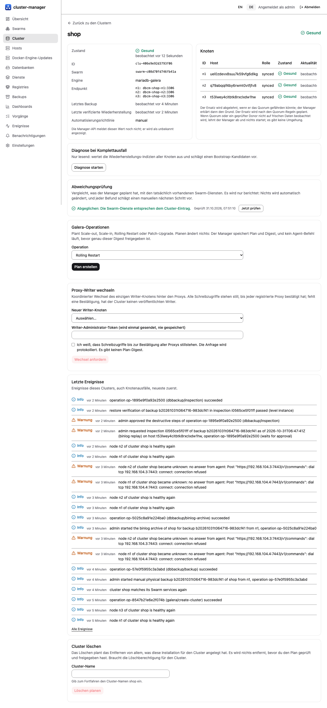

# Knotenersatz

[Übersicht](index.md) | Zurück: [Backups und Wiederherstellung](05-backup-restore.md) | Weiter: [Totalausfall](07-full-outage-recovery.md)

## Wann ersetzen

Ein Knoten, dessen Host verloren ist oder dessen Daten Sie bewusst verwerfen. Ein Knoten, der nur neu gestartet wurde, braucht keinen Ersatz: Swarm startet den Task neu, Galera tritt wieder bei (in E4 nach 40 s beobachtet [Lab-VMs]).

## Ablauf

`POST /api/v1/clusters/{id}/nodes/{slot}/replace` (Berechtigung Cluster betreiben, auditiert). Der Plan folgt den Quorum-Regeln aus `galera.PlanReplacement`: Ein geprüfter Donor und eine Primary-Komponente müssen auf **frischen** Daten beobachtet werden. Sonst wird die Anfrage mit `409 requires_guided_recovery` abgelehnt, nichts startet, und es gibt **keine Übersteuerung**. Eine andere unfertige Operation auf dem Cluster ergibt `409 busy`. Mit `autoReplace` bei der Erstellung darf der Manager nur innerhalb derselben Regeln automatisch ersetzen; er umgeht nie das Quorum.

Die Operation wählt nach den Platzierungsregeln einen Zielhost, legt ein neues Volume mit Identitätsmarker an und lässt den neuen Knoten per Zustandsübertragung (SST) beitreten. Die genaue Schrittfolge ist in `internal/galera` und `internal/runner` definiert und lief nur gegen Fakes; lesen Sie den Plan in der Operationsansicht, bevor Sie sich darauf verlassen.

*Echter Screenshot der deutschen Oberfläche: Manager auf Lab-VMs (E16, 2026-10-31).*

## Prüfstand

| Teil | Stufe |
| --- | --- |
| Hostverlust, Rückkehr, Schutz vor leerem Volume, Minderheitspartition auf Dienstebene (Skripte) | [Lab-VMs] (E1/E2) |
| Ersatz über die Manager-API mit echtem Agenten | [Ungetestet]: E4 führte keinen Knotenersatz aus |
| Plan- und Ablehnungslogik (`requires_guided_recovery`, `busy`), durchgängig mit Fake-Agenten | [Fakes] |
| Beitretende Knoten nutzen immer SST (keine IST-Optimierung) | Entwurf, in E4/E5 beobachtet |
| Stromausfall einer VM und geordnetes Leeren eines Hosts | [Ungetestet] |

Nutzen Sie dies nicht zur Behebung eines Totalausfalls: siehe [Totalausfall](07-full-outage-recovery.md).
