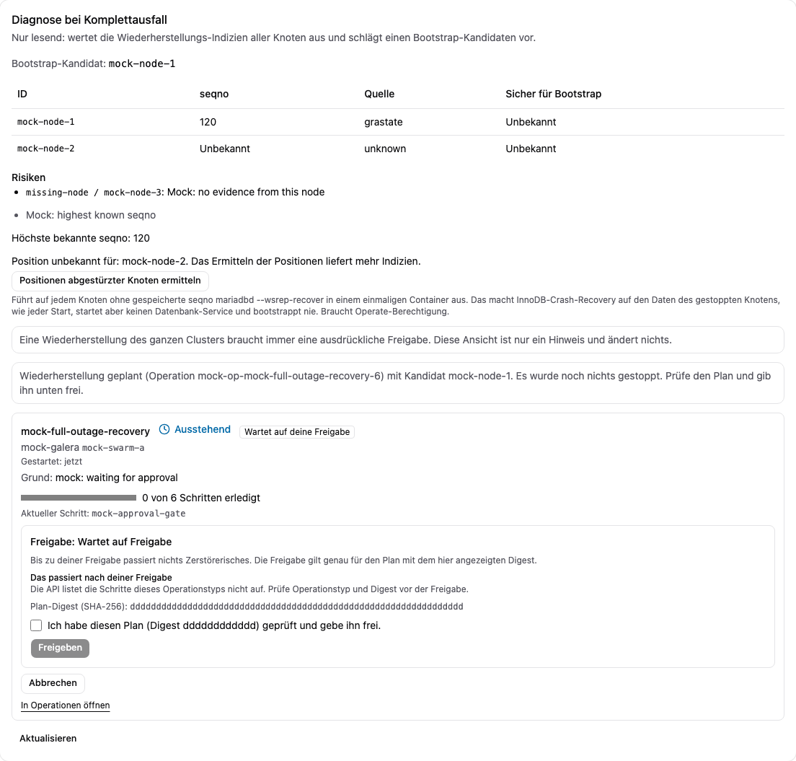

# Wiederherstellung nach Totalausfall mit Freigabe

[Übersicht](index.md) | Zurück: [Knotenersatz](06-node-replacement.md) | Weiter: [Sicherheitsmodell](08-security-model.md)

Ein Totalausfall heißt: Kein Knoten ist in einer Primary-Komponente. Der Manager führt **nie** selbstständig einen Bootstrap aus: Er diagnostiziert nur lesend, schlägt einen Kandidaten vor und handelt erst nach ausdrücklicher Freigabe genau des gezeigten Plans.

## Ablauf

1. **Diagnose (nur lesend):** `GET /api/v1/clusters/{id}/outage-diagnosis`. Liest über die Agenten die `grastate.dat` jedes Knotens und verbindet sie mit der letzten Zustandsbeobachtung. Startet nichts; antwortet `409`, solange eine Primary-Komponente existiert. Das Ergebnis zeigt einen vorgeschlagenen Kandidaten oder begründet, warum es keinen gibt (z. B. Gleichstand bei gleichem Seqno nach sauberem Herunterfahren, oder `seqno: -1` auf allen Knoten nach einem Absturz).
2. **Positionen abgestürzter Knoten ermitteln (ändert nur den Crash-Recovery-Zustand):** `POST /api/v1/clusters/{id}/outage-diagnosis` führt zusätzlich `mariadbd --wsrep-recover` in einmaligen Containern ohne Netzwerk für Knoten ohne gespeichertes Seqno aus. Das ist InnoDB-Crash-Recovery auf den gestoppten Daten wie bei jedem Start; es startet keinen Datenbankdienst und führt nie einen Bootstrap aus.
3. **Plan anfordern:** `POST /api/v1/clusters/{id}/outage-recovery` mit `{"candidate": "<Slot>"}`. Der Manager sammelt die Belege erneut und lehnt mit `409` ab, wenn die frische Diagnose keinen oder einen anderen Kandidaten vorschlägt, eine Primary-Komponente existiert oder eine andere Operation unfertig ist. Sonst speichert er den Plan und liefert einen **Freigabe-Digest**. Noch wird nichts gestoppt oder gestartet.
4. **Freigeben:** `POST /api/v1/operations/{id}/approve` mit dem Digest (sonst `409 approval_mismatch`).
5. Der Plan: alle Knoten stoppen, warten bis kein Task läuft, jeden Identitätsmarker prüfen, Position des Kandidaten erneut prüfen und `safe_to_bootstrap` setzen, Kandidaten bootstrappen, übrige Knoten nacheinander starten, Bootstrap-Flag entfernen.

Den Plan anzufordern braucht die Berechtigung Betreiben auf dem Cluster. **Die Freigabe braucht die eigene Aktion `recover` auf dem Cluster, die nur das Administrator-Preset besitzt**; Betreiber- und Restore-Presets decken sie nicht mehr ab [Fakes]. Wird ein Cluster unerreichbar, erfasst der Manager ein kritisches Ereignis und sendet die Benachrichtigung `health.cluster_outage` (danach `health.cluster_outage_ended`) [Fakes]; er plant nichts selbstständig.

*Bildschirmfoto aus dem Entwicklungs-Mock-Server (`npm run dev:mock`, erfundene Beispieldaten), nicht von einem echten Manager.*

## Wahl des Kandidaten

Folgen Sie der Diagnose. Nennt sie keinen, erzwingen Sie keinen. Bei Verdacht auf Divergenz oder Datenverlust stellen Sie aus einem Backup wieder her ([Backups](05-backup-restore.md)). Der Manager befördert nie automatisch eine Cluster-übergreifende Backup-Kopie.

## Primary-Komponente mit Null-State-UUID (E9)

Nach einem Stromausfall aller VMs bildeten zwei Knoten in E9 aus `gvwstate.dat` eine Primary-Komponente mit `wsrep_cluster_state_uuid = 00000000-0000-0000-0000-000000000000`. Der dritte Knoten scheiterte wiederholt beim SST/IST mit `Failed to parse uuid:seqno pair` und `IST started with wrong seqno`. Der Manager bewertet diesen Befund nun als ungesund und meldet einen kritischen Incident `health.zero_cluster_uuid_primary`. Er zählt die Komponente weder als sicheren Donor noch als Quorum-Beleg für Operationen und bezeichnet sie bei gemeldeter Primary-Komponente nicht als Totalausfall.

Die Endpunkte für Ausfalldiagnose und Wiederherstellung antworten bei dieser Beobachtung mit `409` und `{"error":"conflict","reason":"zero_cluster_uuid_primary"}`. Alle Knotendaten und Logs erhalten, den Zustand der Komponente und die Fehler beim Beitritt prüfen und eine Wiederherstellung erst nach Auflösung der Primary-Komponente durch die verantwortliche Person planen. Keinen Bootstrap erzwingen, keinen Knoten automatisch ersetzen und keine Quorum-Regel umgehen. `409` mit `reason:"no_candidate"` bedeutet, dass die Belege der gestoppten Knoten keinen Bootstrap-Kandidaten stützen; vor einer freigegebenen Wiederherstellung die Positionen prüfen. E9 hat die Ursache diagnostiziert; E12 hat Incident und `409`-Grund am echten Cluster bestätigt (nach dem Stromausfall waren alle drei Knoten in der Primary-Komponente mit Null-UUID, API-Knoten `unavailable`).

### Geführte Null-UUID-Wiederherstellung ([ADR 0029](../../decisions/0029-zero-uuid-recovery.md)) [Fakes]

Die Antwort `409 zero_cluster_uuid_primary` enthält jetzt `"offer":"zero-uuid-recovery"`. Die Wiederherstellung ist das manuelle E12-Verfahren als zwei freigabepflichtige Operationen (das Verfahren selbst wurde im Labor bestätigt; die Automatisierung lief nur gegen Fakes):

1. `POST /api/v1/clusters/{id}/zero-uuid-recovery` (Berechtigung Betreiben) liefert die Vorbereitungs-Operation, den **Snapshot-Namen** und einen Freigabe-Digest. Freigeben mit `POST /operations/{id}/approve` (Berechtigung `recover`, Administratoren). Sie stoppt alle Knoten, wartet bis kein Task läuft, prüft die Identitätsmarker und **kopiert jedes Datenverzeichnis** nach `snapshots/<Name>/` auf demselben Volume. Ohne genug freien Platz wird die Kopie abgelehnt und nichts verändert: Platz schaffen oder die Daten anderswohin kopieren, dann neu starten.
2. Bei gestoppten Knoten liest der Manager jede Position (`wsrep-recover`) und plant die zweite Operation (`GET .../zero-uuid-recovery` zeigt Diagnose, Kandidat und Digest). Kandidat ist der Knoten mit der **eindeutig höchsten** lokalen Seqno. Nach Freigabe wird dort `safe_to_bootstrap` gesetzt, er startet mit einer **neuen State-UUID** (die alte Gruppen-UUID ist verloren), die übrigen starten nacheinander und holen per SST nach, die normalen Argumente werden wiederhergestellt, und eine Zustandsprüfung verlangt alle Knoten Synced in einer Primary-Komponente mit einer gemeinsamen UUID ungleich null. Die Datenprüfung ist diese Zustandsprüfung; Tabelleninhalte werden nicht verglichen.
3. **Mehrdeutigkeit braucht immer einen Menschen:** gleiche höchste Seqno, eine nicht lesbare oder fehlende Position oder weniger als eine Mehrheit lesbarer Positionen. Die Diagnose nennt sie als Risiken (`auto_eligible: false`); ohne Kandidat bleiben die Knoten gestoppt und der Snapshot erhalten.

**Optionale Richtlinie `autoRecover`** (je Cluster, Standard aus, `PUT /api/v1/clusters/{id}/auto-recover`, nur Administratoren): Bei beobachteter Null-UUID-Primary startet der Manager den Lauf und gibt Schritt 1 (Stoppen und Snapshot) selbst frei; Schritt 2 gibt er **nur** selbst frei, wenn alle Positionen lesbar und die höchste Seqno eindeutig sind. Er benachrichtigt vor und nach jedem Lauf (`recovery.planned` / `recovery.needs_approval`, `recovery.ended`), hält nach einem Lauf eine Stunde Pause und fasst nie Images oder Upgrades an. Beachten Sie: Schritt 1 stoppt einen Cluster, der noch aus der Null-UUID-Primary bedient; lassen Sie die Richtlinie aus, wenn Sie das nicht ohne Ihre Freigabe wollen. Der Snapshot ist eine Kopie auf demselben Volume, kein Backup, und wird nie automatisch gelöscht.

Zum Vergleich das manuelle Verfahren, das dies ersetzt [Lab-VMs]: (1) alle Datenbank-Services auf 0 skalieren; (2) die Position jedes Knotens mit einem Einmal-Container auf seinem Volume lesen (`mariadbd --wsrep-recover` mit den Binlog-Optionen des Clusters); (3) den Knoten mit der höchsten Seqno wählen (bei Gleichstand den niedrigsten Slot; nie einen Knoten, der ausfiel, während die anderen weiter schrieben) und in dessen `grastate.dat` `safe_to_bootstrap: 1` setzen; (4) diesen Service mit `--wsrep_cluster_address=gcomm://` aktualisieren und auf 1 skalieren; (5) die übrigen Services auf 1 skalieren, sie holen per SST nach; (6) die normalen Argumente des Bootstrap-Knotens wiederherstellen. Der Cluster erhält eine **neue** State-UUID; in E12 waren danach alle vor dem Stromausfall bestätigten Daten vorhanden. Vorher Kopien der Volumes anlegen; siehe [E12-Ergebnisse](../../../tests/p0/results/e12-recovery-autofailover-rolling.md).

## Prüfstand

| Teil | Stufe |
| --- | --- |
| Totalausfall nach sauberem Herunterfahren und nach Absturz auf einem 3-Knoten-MariaDB-11.4-Cluster: korrekte lesende Diagnose (Gleichstand; kein Kandidat bis `--wsrep-recover`), 120 s keine Änderung, Wiederherstellung nach Freigabe in 40 s und 61 s, Daten und State-UUID erhalten | [Lab-VMs] (E6, letzter Lauf Exit 0) |
| Eine Wiederherstellung, die still eine neue Historie ab `seqno: -1` begann, wurde gefunden und behoben | [Lab-VMs] (E6, mit Regressionstest) |
| 5-Knoten-Cluster, abweichende Datadir-Layouts, Stromausfall einer VM | [Ungetestet] |
| Geführte Null-UUID-Wiederherstellung (zwei Operationen, Snapshot, Richtlinie `autoRecover`, Berechtigungen): das manuelle Verfahren lief in E12 auf VMs, die Automatisierung nur gegen Fakes | [Fakes] |
| Ereignis und Benachrichtigung bei Totalausfall; Berechtigung `recover` für die Freigabe | [Fakes]: nicht auf VMs gelaufen |
