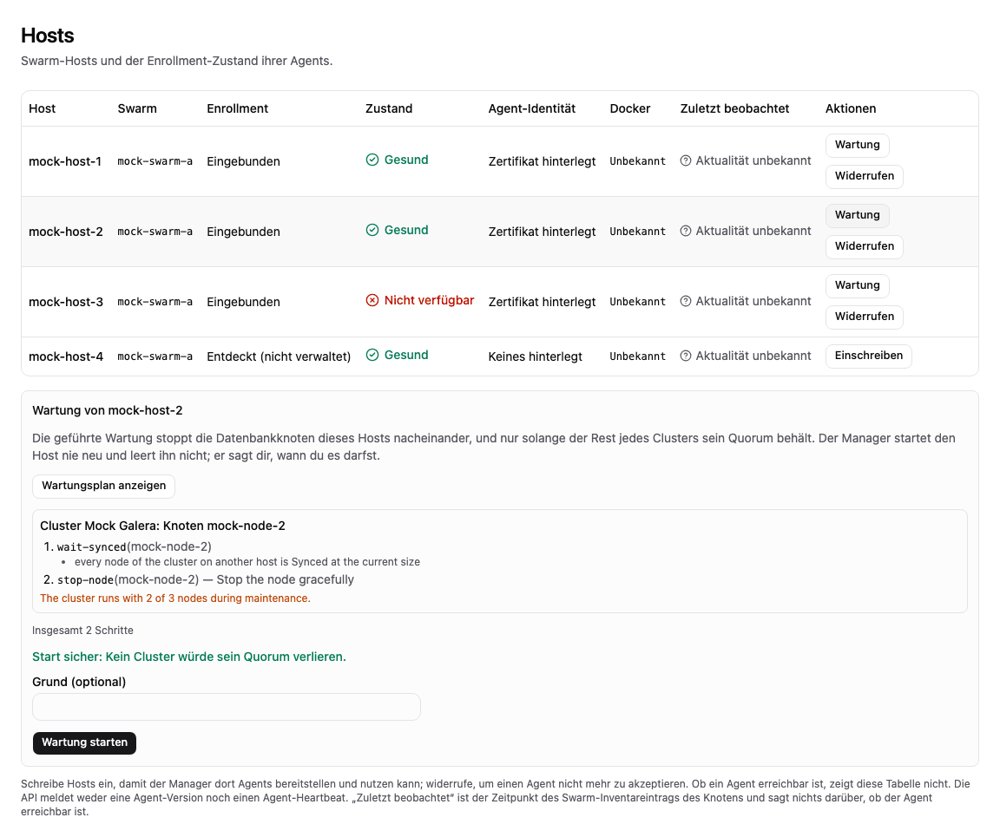
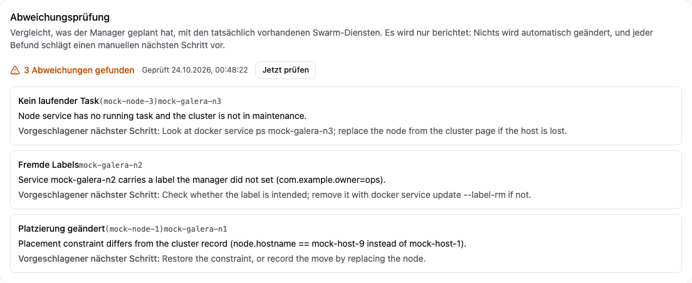
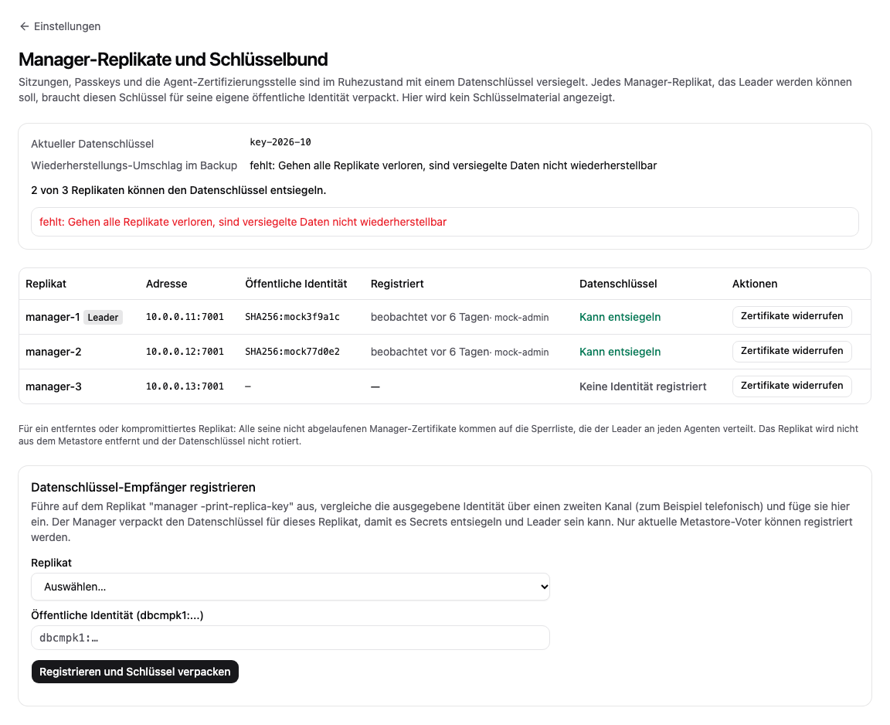

# Betriebshandbuch

[Übersicht](index.md) | Zurück: [Bekannte Grenzen](10-known-limits.md)

Abläufe für die Person, die den Manager betreibt. Jeder Schritt nennt den Prüfstand. Wo es keine Produktfunktion gibt, ist der manuelle Ausweg mit [Ungetestet] gekennzeichnet: Er folgt aus der Art, wie der Zustand gespeichert wird, aber niemand hat daraus eine Wiederherstellung durchgeführt.

## 1. Manager-Zustand sichern

**Produktfunktion:** `internal/backup` kann verschlüsselte Sicherungen der Manager-Konfiguration schreiben, aber kein Planer, keine API und keine Oberfläche ruft es auf [Fakes]. Das R1-Tor „Neuinstallation und Konfigurationswiederherstellung dokumentiert und reproduziert“ ist damit offen.

**Manueller Ausweg [Ungetestet]** (verwalteter Modus, Einzelinstanz):

1. Pfade aus Ihrer Konfiguration notieren: `manager.dataDir` (Metastore, `data.key`, Monitoring-Speicher) und die Konfigurationsdatei.
2. Manager für eine konsistente Kopie stoppen (der Zustand ist ein Raft-Log mit Snapshots in bbolt; keine laufende Instanz kopieren).
3. `dataDir` und Konfigurationsdatei auf Speicher außerhalb des Hosts kopieren. **`data.key` entschlüsselt Konten, Sitzungen, Passkeys und Benachrichtigungs-Secrets: Kopie verschlüsselt und getrennt von den Datenbank-Backups aufbewahren.**
4. Manager starten und `GET /api/v1/health` prüfen.
5. Außerdem aufbewahren: das Recovery-Key-Secret der Cluster-Backups, die Ziel-Konfigurationsdatei (S3/SFTP-Zugangsdaten), Ihre Wiederherstellungscodes sowie die Liste der von Ihnen angelegten Swarm-Secrets und Netzwerke (Namen, nicht Werte).

Testen Sie die Wiederherstellung auf einem Übungsrechner, bevor Sie sie brauchen: `dataDir` mit derselben `nodeId` zurückkopieren, Manager starten, mit Passkey anmelden.

## 2. Manager aktualisieren

Seit es Zustand gibt, wurde kein Upgrade durchgeführt, und eine Schema-Migrationsrichtlinie ist nicht dokumentiert [Ungetestet].

1. Release-Hinweise und [Bekannte Grenzen](10-known-limits.md) lesen. Zuerst die Sicherung aus Abschnitt 1 anlegen.
2. Kompatibilitätsmatrix gegen Ihre Docker-Version prüfen.
3. Einzelinstanz, Container: `DBCM_IMAGE=<neu> docker compose -f deploy/compose.yaml up -d` (Volume bleibt). Prozess-Installation: Binärdatei ersetzen, Unit neu starten. `GET /api/v1/version` und `/api/v1/health` prüfen.
4. Die Agenten laufen mit dem in den Manager-Einstellungen genannten Image. Nach einem Wechsel des Agent-Images `POST /api/v1/swarms/{id}/agents/deploy` ausführen und prüfen, dass jeder Host `agentIdentity: true` meldet [Ungetestet].
5. Laufende Operationen überstehen einen Neustart nur, soweit der Runner sie fortsetzt (`autoResume`); `GET /api/v1/operations` prüfen, anstehende fortsetzen oder abbrechen. Nicht während Backup, Wiederherstellung oder Recovery aktualisieren.
6. Zurückrollen: vorheriges Image und Zustandskopie aus Schritt 1 wiederherstellen. Große Versionssprünge brauchen künftig ausdrückliche Freigabe.

Datenbank-(MariaDB-)Upgrades sind nicht implementiert; große Upgrades brauchen immer Ihre ausdrückliche Freigabe.

## 3. Labor-Bereinigung (nur Testumgebungen)

Labor-VMs werden nur mit `bin/lab` angelegt und entfernt. Es führt ein Besitzmanifest (`.lab/manifest.json`) und fasst nur Namen mit Präfix `dbcm-lab-` an.

```sh
make build
bin/lab status             # nur lesend: Host-Kapazität, Budget, Manifest, fremde Lima/Colima-Einträge
bin/lab cleanup            # Vorschau des auf das Manifest begrenzten Abbaus
bin/lab cleanup -apply     # führt ihn aus; bricht ab, wenn ein fremder Eintrag verschwand
```

Die Experiment-Skripte unter `tests/p0/` legen ihre VMs selbst an und entfernen sie per `bin/lab cleanup -apply` in einer Exit-Falle [Lab-VMs]. Regeln: Laborbudget einhalten (16 GB RAM, 50 % CPU, etwa 100 GB Platte), nie `docker system prune`, nie fremde Colima- oder Lima-Profile entfernen, keine Produktions-Zugangsdaten und -Backups ins Labor. Der freigegebene Speicherplatz nach der Bereinigung wurde nicht geprüft (in W04 war der freie Platz danach geringer). Host-seitige Build-Artefakte im ignorierten Verzeichnis `.lab/` können Sie von Hand löschen.

## 4. Host-Wartung und Drift

**Host-Wartung** [Fakes]: `GET /api/v1/hosts/{id}/maintenance-plan` zeigt je Cluster mit einem Knoten auf dem Host vorab die Schritte, Warnungen und warum ein Cluster ablehnt (weniger als eine strikte Mehrheit seiner Knoten außerhalb des Hosts, eine unfertige Operation). `POST /api/v1/hosts/{id}/maintenance` (optional `reason`) stoppt diese Knoten geordnet nacheinander, jeden erst, wenn alle Knoten des Clusters auf anderen Hosts Synced sind; der Ersatz auf diesem Host ist pausiert. Lehnt ein Cluster ab, antwortet es mit 409 und ändert nichts. `Host.maintenance.ready` sagt, wann Sie den Host selbst neu starten dürfen: **Das Produkt startet nie einen Host neu, leert ihn nicht und ändert seine Swarm-Verfügbarkeit nicht.** `DELETE /api/v1/hosts/{id}/maintenance` prüft jeden Identitätsmarker der Volumes, startet die Knoten nacheinander und wartet auf Synced (IST oder SST). Braucht die Berechtigung Betreiben auf dem Host und seinen Clustern; auditiert.

**Drift** [Fakes]: `GET /api/v1/clusters/{id}/drift` vergleicht den Cluster-Datensatz mit den Swarm-Diensten mit seinem Label (fehlend, außerhalb des Managers neu angelegt, fremde Labels, geänderte Platzierung, auf 0 skaliert oder ohne laufenden Task außerhalb von Wartung und Operationen, unerwartete Dienste). Jeder Befund schlägt einen manuellen Schritt vor; nichts wird geändert. Der Leader prüft auch periodisch und erfasst ein Ereignis, wenn sich die Befunde ändern.

Die Seite **Hosts** bietet pro eingetragenem Host **Wartung**: **Wartungsplan anzeigen** zeigt je Cluster die Schritte und Warnungen oder den Grund, warum der Cluster ablehnt (weniger als eine strikte Mehrheit seiner Knoten bliebe übrig). Nur ein Plan ohne Ablehnung lässt sich starten; der Manager startet den Host nie neu und leert ihn nicht, sondern meldet, wann er bereit ist. Die **Cluster-Detailseite** hat eine Karte **Abweichungsprüfung**, die Unterschiede zwischen Cluster-Eintrag und Swarm-Diensten mit je einem vorgeschlagenen manuellen nächsten Schritt auflistet; automatisch wird nichts geändert.



*Bildschirmfoto aus dem Entwicklungs-Mock-Server (`npm run dev:mock`, erfundene Beispieldaten), nicht von einem echten Manager.*



*Bildschirmfoto aus dem Entwicklungs-Mock-Server (`npm run dev:mock`, erfundene Beispieldaten), nicht von einem echten Manager.*

Nur Ansichten des Mock-Servers [Nur Mock].

## 5. Replikate, Schlüsselring und Peer-Zertifikate

Nichts davon lief mit mehreren Manager-Replikaten auf VMs [Ungetestet]; die Teile sind mit Fakes und Loopback-TLS getestet [Fakes]. Referenz: [Konfigurationsreferenz](12-configuration-reference.md), [ADR 0013](../../decisions/0013-replica-keys-peer-tls-and-revocation.md).

1. **Peer-Zertifikate:** `DBCM_PEER_CA_PASSPHRASE=<mindestens 12 Zeichen> manager -issue-peer-certs ./peers -installation inst-1 -peer-ids manager-1,manager-2,manager-3`. Das schreibt `ca.pem`, `ca.sealed` (die verschlüsselte CA) und je Replikat ein Verzeichnis mit `peer.pem` und `peer-key.pem`. Jedes Replikat-Verzeichnis auf seinen Host kopieren; `ca.sealed` und die Passphrase bleiben offline. Der Befehl überschreibt keine vorhandene CA.
2. **Konfiguration:** auf jedem Replikat `peers` (dieselbe Liste), `bootstrap: true` für den ersten Start, `keyring: true` und `peerTLS` setzen. Peer-Zertifikate erneuert das Produkt nicht: vor Ablauf (Standardgültigkeit 365 Tage) mit der versiegelten CA neu ausstellen; das Replikat liest eine geänderte Zertifikatsdatei ohne Neustart neu.
3. **Erstes Replikat:** starten. Eine vorhandene `data.key` wird als erster Schlüssel des Schlüsselrings übernommen; es wird keine neue Schlüsseldatei angelegt.
4. **Weitere Replikate registrieren:** auf jedem `manager -print-replica-key -config <Datei>` ausführen (legt bei Bedarf `<dataDir>/replica.key` an) und den öffentlichen Schlüssel samt Fingerabdruck notieren. Auf einem anderen Weg vergleichen, dann als Administrator `PUT /api/v1/settings/replicas/{id}/data-key-recipient` mit dem öffentlichen Schlüssel (`dbcmpk1:...`) aufrufen. Nur aktuelle Voter werden akzeptiert; nichts wird automatisch registriert. Ein Replikat, das ohne den Schlüssel Leader wird, gibt die Leadership ab, ein nicht registriertes Replikat bedient die API also nicht. `GET /api/v1/settings/replicas` zeigt den Zustand des Schlüsselrings und ob die Schlüssel `recoverable` sind.
5. **Wiederherstellung:** Ist `settings.backup.recipientKey` konfiguriert, hat jeder Datenschlüssel auch einen Umschlag für den Backup-Recovery-Key; bewahren Sie dessen privaten Teil außerhalb des Clusters auf. `<dataDir>` wie in Abschnitt 1 sichern.
6. **Replikat abschneiden:** `POST /api/v1/settings/replicas/{id}/revoke-certificates` sperrt seine Manager-Zertifikate an jedem Agenten. Schlüssel, die das Replikat schon entpackt hat, nimmt das nicht zurück; Rotation und Neuverschlüsselung haben jetzt eine Digest-Freigabe nur für globale Administratoren (siehe [Sicherheitsmodell](08-security-model.md)); bereits gelernte Schlüssel werden nicht zurückgenommen.

**Einstellungen > Manager-Replikate und Schlüsselbund** listet jedes Replikat mit dem Fingerabdruck seiner registrierten öffentlichen Identität und ob der aktuelle Datenschlüssel für es verpackt ist, warnt bei fehlendem Wiederherstellungs-Umschlag, registriert einen Datenschlüssel-Empfänger (Format `dbcmpk1:...`, vorher über einen zweiten Kanal vergleichen) und widerruft nach Rückfrage alle Manager-Zertifikate eines Replikats. Schlüsselmaterial wird nie angezeigt.



*Bildschirmfoto aus dem Entwicklungs-Mock-Server (`npm run dev:mock`, erfundene Beispieldaten), nicht von einem echten Manager.*

Nur Ansicht des Mock-Servers [Nur Mock].

## 6. Manager-Installation entfernen

`docker compose -f deploy/compose.yaml down` (mit `-v` wird das Volume `manager-data` gelöscht) oder `docker stack rm dbcm` samt Volume auf jedem Knoten. Der Manager entfernt keine von ihm angelegten Agenten, Datenbankdienste oder Volumes. Löschen Sie Cluster zuerst über die API (Freigabe nötig, siehe [Cluster anlegen](03-create-cluster.md)); entfernen Sie dann den Agent-Dienst, die Host-Verzeichnisse unter der Volume-Basis sowie Netzwerke und Secrets des Betreibers namentlich. Nie global aufräumen.

## 7. Galera skalieren und rollend warten

[Nur Fakes] `POST /api/v1/clusters/{id}/operation-plan` speichert einen Plan und liefert `id`, `approval.digest`, `plan` (mit Warnungen und Zielknoten) sowie `agentSteps`. Dafür ist **operate** auf dem Cluster erforderlich. Der Cluster bleibt bis zum Abschluss oder Abbruch reserviert; vor der Freigabe wird kein Agent-Befehl gesendet. Antwort prüfen und mit `POST /api/v1/operations/{id}/approve`, Body `{"digest":"<approval.digest>"}`, freigeben. Der Digest bindet die gespeicherte Runner-Definition. Die Planantwort aufbewahren; `GET /api/v1/operations/{id}` zeigt Status und Freigabe-Digest. Vor einem anderen Plan den bestehenden über `POST /api/v1/operations/{id}/abort` abbrechen.

Mögliche Request-Bodies:

- Einen Knoten hinzufügen: `{"kind":"scale-out","slot":"n4"}`. Ein eindeutiger Slot und ein geeigneter freier, registrierter Host sind erforderlich; Identität und Volume werden neu vergeben. Vor dem Beitritt müssen Donor und gesamte Komponente Synced sein.
- Einen Knoten entfernen: `{"kind":"scale-in","slot":"n4"}`. Mindestens drei Knoten müssen verbleiben. Nach geordnetem Stoppen und Synchronisationsprüfung der verbleibenden Knoten wird der Service entfernt; das alte Volume bleibt zur Prüfung erhalten. Die Dateien belegen weiterhin Speicher; ihre Bereinigung braucht einen gesonderten freigegebenen Vorgang.
- Rollender Neustart/Wartung: `{"kind":"rolling-restart"}`. Jeden Knoten einzeln stoppen, verbleibende Mehrheit prüfen, Volume-Identität prüfen, Spec im gestoppten Zustand aktualisieren und ausdrücklich starten. Vor dem nächsten Stopp muss die gesamte Komponente Synced sein. Für Wartung mit einer Pause während manueller Arbeiten am Host gilt Abschnitt 4.
- Kleines Wartungsupdate: `{"kind":"minor-upgrade","image":"mariadb:11.4.14@sha256:<64 kleine Hexzeichen>"}`. Platzhalter durch den Digest des geprüften Images ersetzen; das Beispiel beschreibt die Syntax und empfiehlt keine Version. Quelle und Ziel brauchen explizite `x.y.z`-Tags mit unveränderlichen Digests. Unterstützt sind ausschließlich steigende Patch-Versionen derselben MariaDB-Serie und desselben Repositorys. Serienwechsel (etwa 11.4 auf 11.8), Major-Wechsel, Downgrades und mehrdeutige Tags werden abgelehnt. Major-/Serienwechsel brauchen eine Produktentscheidung und einen kuratierten Upgradepfad; eine Vorgangsfreigabe umgeht diese Ablehnung nicht.

Vor der Planung müssen alle Knoten frische Synced-/Primary-Beobachtungen derselben Cluster-Historie haben. Unbekannte, veraltete, widersprüchliche oder beeinträchtigte Zustände blockieren den Request. Vor jedem Stopp und Start werden Quorum und Synchronisation live geprüft. Direkte Verbindungen können abbrechen; Proxys schließen gestoppte Knoten über ihre Gesundheitsprüfung aus. Es gibt kein automatisches Downgrade und keinen Full-Cluster-Bootstrap. Bei pausierten Prüfungen zuerst den Zustand untersuchen, Ursache beheben und dann `POST /api/v1/operations/{id}/resume` verwenden. Nach einem Leaderwechsel übernimmt der neue Leader die gespeicherten Schritte mit seiner Fencing-Term. Unterbrochene Vorgänge bleiben zur Untersuchung erhalten; ein Abbruch ist kein Rollback. Teiländerungen vor einem neuen Plan prüfen.

Geprüft wurden Unit-Tests, der echte Agent-Executor mit Docker im Arbeitsspeicher und Leaderwechsel mit Raft im Prozess. Für diese Funktion wurden keine reale Datenbank, Image-Upgrades, SST, Swarm oder sonstige Infrastruktur angesprochen. Freigegebene Versionspfade benötigen vor dem Einsatz weiterhin Labornachweise.
