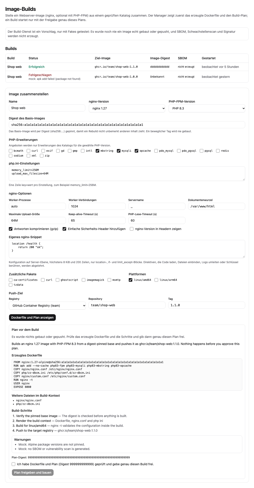
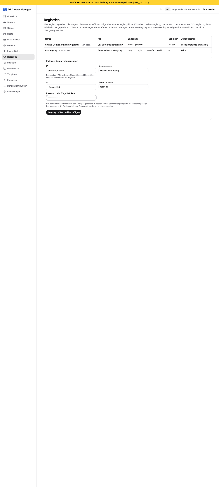

# Image-Builds und Registries (Entwurf)

[Handbuch-Index](index.md) | Zurück: [Konfigurationsreferenz](12-configuration-reference.md)

**Status: nur [Fakes].** Das Backend existiert (Plan-Vorschau, Freigabe-Digest, Build-Protokolle, Registry-Client) und ist jetzt mit replizierter Speicherung im Manager verdrahtet (siehe unten), wurde aber nur gegen Fakes getestet: einen Fake-`docker`-Befehl und `httptest`-Registries. Die Oberfläche lief nur gegen den Mock-Server, und es wurde nie ein echtes Image gebaut oder gepusht. Nicht darauf verlassen.

## Was vorhanden ist

- **Komposition:** nginx-Version, optional PHP-FPM-Version, PHP-Erweiterungen und `php.ini`-Werte aus Positivlisten, strukturierte nginx-Optionen, ein größenbegrenzter eigener nginx-Ausschnitt, zusätzliche Pakete, Plattformen. Das Basis-Image muss per Digest festgelegt sein.
- **Plan vor dem Build:** `POST /image-builds` ohne `approvalDigest` liefert Dockerfile, Kontextdateien, Schritte, Warnungen und eine Erklärung. Ein Build startet nur mit dem Digest dieses Plans.
- **Registries:** `POST /registries` registriert eine externe GHCR-, Docker-Hub- oder generische Registry. Das Passwort wird als Secret gespeichert und weder zurückgegeben noch protokolliert. Eine vom Manager betriebene `registry:2` ist nur eine Deploy-Spezifikation.
- **Aufzeichnung:** Jeder Job speichert Spec-Hash, Digests der Basis-Images, Image-Digest, einen SBOM-Platzhalter (nicht erzeugt) und ein geschwärztes Protokoll.

## Im Manager (verdrahtet, nur Fakes)

- **Speicherung:** Registries, Build-Jobs und Vorschau-Pläne liegen im replizierten Metastore (Sammlungen `registries`, `image-jobs`, `image-plans`) und überstehen Neustarts und Leaderwechsel. Ein Registry-Passwort wird mit dem Datenschlüssel (`keyFile` oder `keyring`) in einer eigenen Sammlung versiegelt; Registry-Einträge enthalten nur eine Referenz, und weder API noch Jobs, Pläne oder Protokolle enthalten es. Höchstens 200 Pläne bleiben erhalten (älteste werden entfernt).
- **Builder:** Mit einem Abschnitt `manager.imageBuild` ([Konfigurationsreferenz](12-configuration-reference.md#managerimagebuild), `manager init -image-build`) führt der Manager nach der Freigabe `docker buildx build` als eigenen Prozess im Hintergrund aus. Ohne den Abschnitt antwortet `POST /image-builds` mit 503; Registries funktionieren weiter.
- **Neustart:** Ein durch Neustart oder Leaderwechsel unterbrochener Build kann nicht fortgesetzt werden. Beim Start eines Leaders werden noch `running` stehende Jobs als `failed` („interrupted") markiert.
- **Schwärzung:** Job-Protokoll und Fehlertext werden vor dem Speichern geschwärzt (bekannte Geheimnisse, Basic-Auth-Form, Zugangsdatenmuster; bestmöglich).
- **Berechtigung:** `image_build` und `registry` sind eigene Ressourcen; Betrachter lesen, Operatoren planen und starten zusätzlich Builds, nur Administratoren registrieren Registries. Jede Entscheidung, auch Ablehnungen, wird protokolliert.

## Grenzen

Das Manager-Image enthält kein Docker-CLI und der Stack kein BuildKit; Builds funktionieren im mitgelieferten Deployment daher nicht ohne zusätzliche Arbeit. Der Build läuft als Manager-Prozess auf dem Host des Leaders (Zugriff auf den Docker-Socket). Das Registrieren einer Registry kontaktiert sie vom Manager aus (Prüfung der Zugangsdaten). Löschen oder Ändern einer Registry und Löschen von Jobs sind nicht implementiert. Pläne werden zur Nachvollziehbarkeit gespeichert, eine API zum Lesen gibt es noch nicht.

Kein echter Build, Push, keine SBOM, kein Schwachstellenscan, keine Signatur. Alpine-Paketversionen sind nicht festgelegt. Nach der Offline-Prüfung ist jeder Katalogeintrag als ungeprüft markiert; siehe [Katalog-Herkunft](../../IMAGEBUILD-CATALOG.md). Die Ausschnittsprüfung ist eine Sperrliste, kein Parser. Siehe [Bekannte Grenzen](10-known-limits.md) und [STATUS.md](../../STATUS.md).

## In der Web-Oberfläche (nur Mock)

Die Seite **Image-Builds** listet aufgezeichnete Builds (Status, Ziel-Image, Image-Digest, SBOM-Platzhalter) und enthält den Webserver-Composer: nginx- und PHP-Version, PHP-Erweiterungen (nur die, die der Katalog für die gewählte PHP-Version anbietet), `php.ini`-Werte, nginx-Optionen, ein optionales eigenes Snippet, zusätzliche Pakete, Plattformen und das Push-Ziel. **Dockerfile und Plan anzeigen** zeigt das erzeugte Dockerfile, die weiteren Kontextdateien, Schritte und Warnungen sowie den Plan-Digest. Der Build-Knopf bleibt gesperrt, bis man bestätigt, genau diesen Plan geprüft zu haben; jede spätere Änderung am Formular macht den Plan ungültig. Das Basis-Image muss per Digest angegeben werden.

*Bildschirmfoto aus dem Entwicklungs-Mock-Server (`npm run dev:mock`, erfundene Beispieldaten), nicht von einem echten Manager.*

Die Seite **Registries** listet Registries (nie Zugangsdaten, nur ob welche gespeichert sind) und fügt eine externe GHCR-, Docker-Hub- oder generische OCI-Registry hinzu. Das Passwortfeld ist nur schreibbar: Es wird einmal gesendet und sofort aus der Seite entfernt.

*Bildschirmfoto aus dem Entwicklungs-Mock-Server (`npm run dev:mock`, erfundene Beispieldaten), nicht von einem echten Manager.*

Beide Seiten liefen nur gegen den Mock-Server [Nur Mock].
