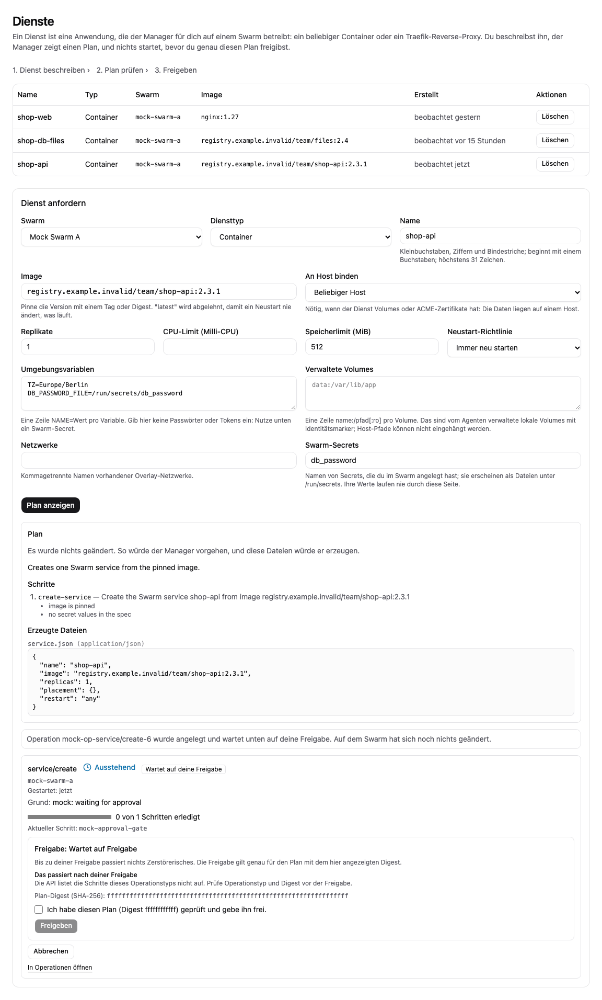
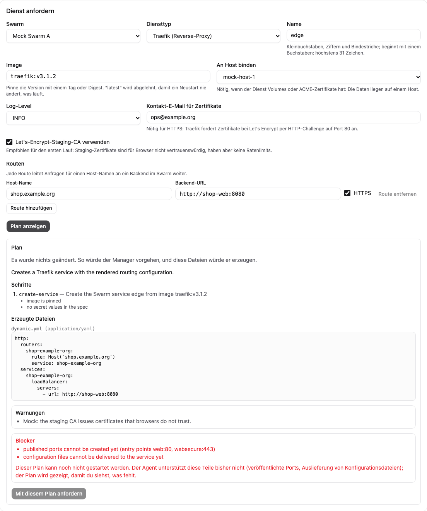

# Dienste

[Handbuchindex](index.md) | Zurück: [Konfigurationsreferenz](12-configuration-reference.md)

**Stand: nur [Fakes].** Das Dienstetyp-Framework (Arbeitspaket W07, Anforderungen X03, X06 und X07 in [KONZEPT.md](../../KONZEPT.md)) existiert als Code mit Unit-Tests. Es lief nie gegen einen Swarm, Docker oder Traefik, und die Oberfläche dafür lief nur gegen den Mock-Server. Für die unten beschriebenen UI-Erweiterungen gibt es Unit-Tests; Browserprüfung und Prüfung am echten Manager stehen noch aus.

## Was es gibt

Sieben Dienstetypen (generischer Container, Traefik, MariaDB Galera und vier Speicher-Protokollserver), geplant von reinem Code (`internal/service`) und über die Manager-API erreichbar:

- **container**: ein generischer Docker-Dienst mit festgelegtem Image, Umgebung, Swarm-Secrets, Netzwerken, verwalteten lokalen Volumes, Ressourcen, Platzierung und Neustart-Richtlinie.
- **traefik**: ein Traefik-Dienst mit einem typisierten Modell aus Entry Points, ACME-Zertifikatsresolvern, Routern, Services (Backends) und Middlewares. Der Manager rendert statische und dynamische Konfiguration als YAML zur Prüfung.
- **galera**: ein MariaDB-Galera-Cluster. Die Spezifikation hat die Felder der Cluster-Anlage (`size`, `image`, `network`, `rootPasswordSecret`, `gcacheSize`, `resources`, `placement`, `autoReplace`). Der Typ ändert keine Sicherheitsregel: Jeder Plan kommt unverändert aus dem Galera-Planer, und jede Anforderung läuft über den bestehenden Cluster-Ablauf (siehe unten).

## Galera als Dienstetyp

Ein galera-Dienst *ist* ein Cluster: `GET /api/v1/services` listet jeden Cluster als galera-Dienst, und dieselbe ID gilt unter `/api/v1/clusters`.

- **Anlegen** über `POST /api/v1/services` führt genau die Cluster-Anlage von `POST /api/v1/clusters` aus: derselbe Plan, dieselbe Operation (Tests vergleichen sie Schritt für Schritt) und dieselbe Berechtigung (`create` auf die Cluster-Ressource, nicht auf die Dienst-Ressource). Wie der direkte Weg startet sie ohne Freigabeschritt; die Antwort hat einen leeren Freigabe-Digest.
- **Löschen** über `DELETE /api/v1/services/{id}` ist die Cluster-Löschung mit ihrer Freigabe (`delete` auf den Cluster).
- **Knoten ersetzen, geführte Wiederherstellung, Wartung und Sicherungen** bleiben auf den Cluster-Seiten und -Routen. Die Quorum- und Spenderprüfung beim Ersetzen, die Freigabe einer Komplettausfall-Wiederherstellung, die Deny-Liste und die Eigentumsregeln sind unverändert; die Dienste-API bietet keinen Weg daran vorbei.
- **Nicht unterstützt**: ein galera-Dienst mit der allgemeinen Update-Strategie aktualisieren (409; Galera-Knoten werden einzeln hinter Synchronisations-Gates aktualisiert) und die Clustergröße ändern (dafür gibt es keinen Planer).
- Eine Rolle, die Dienste verwalten darf, aber keine Cluster-Berechtigung hat, kann einen galera-Dienst weder sehen noch anlegen noch löschen.

## Updates

`POST /api/v1/services/{id}/update-plan` zeigt und `POST /api/v1/services/{id}/update` beantragt ein Update eines container- oder traefik-Dienstes. Der Body enthält die neue `spec` und eine `strategy`:

| Feld | Standard | Bedeutung |
| --- | --- | --- |
| `order` | `stop-first` | `stop-first` stoppt den alten Task vor dem Start des neuen; `start-first` startet zuerst den neuen. `start-first` wird bei Diensten mit lokalen Volumes abgelehnt (zwei Tasks dürfen kein Volume teilen). |
| `parallelism` | 1 | Gleichzeitig ersetzte Tasks. |
| `delaySeconds` | 0 | Pause zwischen den Gruppen. |
| `monitorSeconds` | 30 | Wie lange Swarm jeden neuen Task beobachtet. |
| `maxFailureRatio` | 0 | Tolerierter Anteil fehlgeschlagener Tasks. |
| `onFailure` | `rollback` | `rollback`: Swarm stellt die vorige Spezifikation wieder her, wenn ein neuer Task innerhalb der Beobachtungszeit scheitert (endet oder seinen Container-Healthcheck nicht besteht). `pause`: Swarm hält das Update an. |
| `canary` | keins | Wird angenommen, ist aber noch nicht ausführbar: Ein Plan mit Canary hat einen Blocker. |

Der Plan hat drei Schritte: `update-service` (der vorhandene Agent-Befehl, mit der Strategie als Swarm-Update- und -Rollback-Konfiguration), `await-service` (scheitert, wenn Swarm das Update zurückgerollt oder angehalten hat) und ein Gesundheits-Gate (jeder gewünschte Task muss laufen). Hält das Gate nicht, pausiert die Operation; bei unbekannter Gesundheit meldet sie nie Erfolg. Das Update wartet wie Anlegen und Löschen auf eine Freigabe (Berechtigung `update` auf den Dienst).

Die gespeicherte Spezifikation ändert sich erst nach erfolgreichem Update; die alte bleibt dann erhalten, und `{"rollback": true}` (ohne Spezifikation) plant das Update zurück zu ihr. Jeder Update-Plan zeigt außerdem seinen vorbereiteten Rollback-Plan. Das `update-service` des Agenten kann Replikatzahl, Platzierung und Volumes nicht ändern: Eine solche Änderung ist ein Blocker (stattdessen löschen und neu anlegen).

## Gesundheit

Der Manager leitet die Gesundheit eines container- oder traefik-Dienstes aus dem Swarm-Task-Zustand seines eigenen Dienstes ab (laufende gegen gewünschte Tasks und der Swarm-Update-Zustand): `healthy`, `degraded` (einige Tasks laufen, oder ein zurückgerolltes oder angehaltenes Update), `unhealthy` (kein Task läuft) oder `unknown` (nicht beobachtet oder älter als zwei Minuten; nie als gesund angezeigt). `GET /api/v1/services` zeigt sie an. Ein Wechsel zwischen gesund und nicht gesund wird als Ereignis gespeichert und an die Benachrichtigungskanäle geschickt (`health.service_unhealthy`, `health.service_recovered`); während ein Dienst angelegt, aktualisiert oder gelöscht wird, gibt es keine Benachrichtigung. Für galera-Dienste ist die Gesundheit der wsrep-basierte Zustand des Clusters.

## Planvorschau, Export und Expertenansicht

Jeder Plan-Endpunkt (`/services/plan`, `/services/{id}/delete-plan`, `/services/{id}/update-plan`) liefert neben den lesbaren Schritten die **Expertenansicht** `agentSteps`: die genauen Agent-Befehle der Operation mit Zielhost, den Argumenten, wie der Agent sie erhält, und den vorher geprüften Bedingungen. In einer Vorschau sind Operations-, Token- und Freigabe-IDs (bei galera auch Cluster- und Knoten-IDs) vorläufig (`provisionalIds`); ein Start vergibt neue, alles andere ist gleich. Die Antwort einer gestarteten Anforderung zeigt die Schritte der gespeicherten Operation selbst. Mit `?format=yaml` wird dasselbe Dokument als YAML (`application/yaml`) statt JSON exportiert. Argumente enthalten nie Geheimnisse.

Die Speichertypen (SFTP, FTP/FTPS, S3-kompatibler Objektspeicher, NFS) stehen unten unter [Speicherserver](#speicherserver-w09-nur-fakes). Regeln der Typen: Images müssen festgelegt sein (kein `latest`); Umgebungsvariablen, die nach Geheimnissen aussehen (`*_PASSWORD`, `*_TOKEN`, ...), werden abgelehnt und müssen ein Swarm-Secret mit der `_FILE`-Konvention nutzen; Volumes sind verwaltete lokale Volumes mit Identitätsmarker, nie Host-Pfade, und brauchen einen festen Host und ein Replikat. Gerenderte Konfiguration enthält nie Geheimnisse.

## Ablauf

1. `POST /api/v1/services/plan` zeigt den Plan (Schritte, erzeugte Artefakte, Warnungen, Blocker), ohne etwas zu ändern.
2. `POST /api/v1/services` legt eine Operation an und wartet. Jeder zustandsändernde Schritt braucht eine Freigabe, die an den Digest der geplanten Operation gebunden ist.
3. `POST /api/v1/operations/{id}/approve` mit diesem Digest lässt sie laufen. Die Freigabe braucht die Berechtigung `create` (bei Löschung `delete`, bei einem Update `update`) auf die Ressource `service` im Swarm.
4. `DELETE /api/v1/services/{id}` plant das Entfernen auf dieselbe Weise; Volumes und Daten bleiben erhalten, außer `removeVolumes` ist gesetzt.

Berechtigungen sind standardmäßig verweigert. Die Presets Viewer und Operator können Dienste nur lesen; das Administrator-Preset darf alles. Jede Entscheidung wird protokolliert.

## Speicherserver (W09, nur Fakes)

Vier Typen folgen einem Muster: Sie geben Image, festen Host und Namen von Swarm-Secrets an; der Manager plant ein verwaltetes lokales Volume (Identitätsmarker, ein Replikat, an den Host gebunden), den Swarm-Dienst und Prüfartefakte. Die genannten Images sind **Vorschläge** für den ersten Laborlauf, keine Abhängigkeiten; jeder Typ beschreibt, was das Image lesen muss.

| Typ | Was geplant wird | Image-Vertrag (Vorschlag) | Hinweise |
| --- | --- | --- | --- |
| `sftp` | SSH-Port 22, standardmäßig im Host-Modus veröffentlicht, Benutzer mit Passwort- und/oder authorized_keys-**Secrets**, optionales Hostschlüssel-Secret | `DBCM_SFTP_*`-Variablen, Benutzerdatei `/etc/dbcm/sftp-users.json` aus einer vorhandenen Swarm-Config (`usersConfig`) | Kandidat: `atmoz/sftp` mit dünnem Wrapper |
| `ftp` | Kontrollport (21, bei implizitem TLS 990) und ein passiver Portbereich, 1:1 im Host-Modus veröffentlicht, Secrets für Zertifikat und Schlüssel | `DBCM_FTP_*`-Variablen (Modus, passiver Bereich und Adresse, TLS-Dateien) | Reines FTP braucht `allowPlaintext`; die passive Adresse ist Pflicht; höchstens 100 passive Ports |
| `s3` | S3-API auf 9000, optional Konsole auf 9001, Root-Benutzer und -Passwort als **Secrets**, optionale Traefik-Routen (Labels und File-Provider-Ausschnitt) | MinIO-Konventionen (`MINIO_ROOT_USER_FILE`, `MINIO_ROOT_PASSWORD_FILE`, `server /data`) | Ein-Laufwerk-Modus: kein Erasure Coding, keine Replikation |
| `nfs` | NFSv4 auf 2049, gerenderte Exports-Datei | Kernel-NFS-Server | **Immer blockiert**: braucht `CAP_SYS_ADMIN` (privilegierter Modus) und das Modul `nfsd`; Swarm-Dienste können nicht privilegiert laufen, der Agent hat kein Capability-Feld. Machbarkeit ist eine R8-Laborfrage; der Typ kann zurückgestellt werden |

Jeder Plan zeigt: das Swarm-Dienst-JSON, die veröffentlichten Ports (`published-ports.json`), ein Benutzer- oder Exports-Artefakt (nur Secret-Namen und `/run/secrets/<name>`-Pfade, nie Werte), Warnungen (Image nur per Tag, kein Speicherlimit, keine Sicherung, kein TLS, ein Laufwerk, `no_root_squash`, direkt veröffentlichte Konsole) und Blocker. `requireDigest: true` lehnt ein Image ab, das nicht per Digest festgelegt ist; ohne die Option gibt ein Tag eine Warnung.

Secrets sind Swarm-Secrets, die Sie vorher angelegt haben. Spezifikation, Plan, Logs und Operationsprotokolle enthalten nur ihre Namen. Ein Klartext-Feld `password` gibt es nicht, und Umgebungsvariablen, die nach Geheimnissen aussehen, werden wie bei jedem Container abgelehnt.

**Traefik-Routing für S3.** `apiRoute` und `consoleRoute` nehmen Hosts, Entry Points, TLS und einen Zertifikatsresolver als typisierte Werte. Der Plan setzt die `traefik.*`-Labels am Dienst (für ein Traefik mit Swarm-Provider, den der Traefik-Typ noch nicht aktiviert) und rendert dieselbe Route als File-Provider-Ausschnitt. Der Manager legt diesen Ausschnitt noch nicht ab (siehe Grenzen).

**Traefik-Verwaltungsmetadaten.** Ein Traefik-Plan enthält jetzt `traefik-management.json` (Entry Points, Router mit Hosts, Backends, Middlewares, Resolver, Pfad der dynamischen Datei, Dashboard und unsichere API aus), damit eine Oberfläche zeigen kann, was die Instanz enthält.

## Was der Agent jetzt kann

`create-service` akzeptiert veröffentlichte Ports (`ports`: Ziel, veröffentlicht, Protokoll, Modus ingress oder host) und Verweise auf vorhandene Swarm-**Configs** (`configs`: Name oder ID, absoluter Zielpfad, Modus). Eine referenzierte Config muss zur Installation gehören und wie Netzwerke und Secrets auf der Allow-List stehen; sie wird an die geprüfte ID gebunden. Eine Spezifikation ohne die neuen Felder wird wie bisher kodiert und gehasht.

## Bekannte Grenzen

- **Swarm-Configs können noch nicht angelegt werden**: Der Agent hängt eine vorhandene Config ein, hat aber keinen Befehl, sie anzulegen oder zu entfernen. Die dynamische Traefik-Konfiguration (Router, Services, Middlewares) blockiert deshalb weiterhin ihren Plan, und die SFTP-Benutzerdatei muss von Hand angelegt werden (`usersConfig`), sonst warnt der Plan.
- Veröffentlichte Ports funktionieren in Agent und Docker-Client nur gegen Fakes; nichts lief auf einem Swarm. Es lief kein Speicherserver-Image, also gibt es keinen Client-Zugriffstest, keine Zugangsdaten-Rotation und keine Sicherung (alle R8-Abnahmekriterien sind offen).
- Typisierte Formulare gibt es für alle sieben Diensttypen. CLI und Sicherung/Wiederherstellung von Speicher-Volumes fehlen. Optionale S3-Traefik-Routen und erweiterte Galera-Platzierung sind in diesen Formularen nicht verfügbar.
- Gesundheit, Updates, Rollback, der galera-Typ und die Experten-/Exportansicht existieren nur mit Fakes: Kein Update, kein Rollback und keine Gesundheitsbeobachtung lief gegen einen echten Swarm, und das automatische Rollback-Verhalten von Swarm stammt aus der Docker-Dokumentation, nicht aus einem Laborlauf.
- Kein Canary-Rollout (das Feld blockiert nur), kein automatisches Rollback durch den Manager (der Rollback-Plan muss beantragt und freigegeben werden), keine Sicherung von Dienst-Volumes, keine CLI.
- Die Oberfläche enthält Zustand, Image-Updates, Rollback, Expertenansicht und Downloads. Die Browserprüfung dieser Ergänzungen steht aus; siehe die Aufnahmegrenze unten.

## In der Web-Oberfläche (nur Mock)

Die Seite **Dienste** listet alle sieben Typen. Swarm, Typ, Name und festgelegtes Image wählen und die typspezifischen Felder ausfüllen. Zuerst **Plan anzeigen** wählen und Schritte, Dateien, Warnungen und Blocker prüfen. Änderungen am Formular machen die Vorschau ungültig. Ein blockierter Plan kann nicht angefordert werden. Dynamische Traefik-Konfiguration bleibt blockiert, weil der Agent keine Swarm-Configs ausliefern kann; veröffentlichte Ports sind kein Blocker mehr.

| Typ | Formularfelder |
| --- | --- |
| Galera | Größe, Netzwerk, Secret-Name des Root-Passworts, Gcache, CPU-/Speicherlimits und automatischer Einzelknotenersatz. Nutzt Cluster-Berechtigungen und startet ohne Freigabeschritt. **Cluster öffnen** führt zu Ersatz, Wiederherstellung und Backups. |
| SFTP | Fester Host, Image/Digest-Pflicht, Netzwerke, Ressourcen, SSH-Port/-Modus, vorhandene Benutzer-Config, Hostschlüssel-Secret sowie mehrere Benutzer mit Name, UID/GID, Home, Nur-Lesen-Option und Secret-Namen für Passwort/Schlüssel. UID: 1000–60000. Home darf leer oder ein absoluter Unterpfad sein, nicht `/`. Port 0 hält SSH intern. |
| FTP / FTPS | Benutzer, Transportmodus, explizite Klartextfreigabe, Steuerport, passiver Bereich (höchstens 100 Ports), passive Adresse, Zertifikat-/Schlüssel-Secret-Namen und Portmodus. Bei implizitem FTPS den Steuerport auf 990 setzen. |
| S3 | Secret-Namen für Root-Benutzer/-Passwort, Region/Domain, API-Port, Konsolenschalter/-Port, Portmodus und lokale Ressourcen. Port 0 hält einen Endpunkt intern. Ein Konsolenport benötigt den Konsolenschalter. Keine Replikation oder Speichersicherung. |
| NFS | Mehrere Freigaben mit Pfad, expliziten IPs/CIDRs, Nur-Lesen-Option und Squash-Regel sowie Port und lokale Ressourcen. Nur Vorschau: Der Manager blockiert die Ausführung immer. |

Die referenzierten Swarm-Secrets vorher anlegen; ausschließlich ihre **Namen**, nie Inhalte eingeben. Storage-Images müssen den oben beschriebenen Protokollvertrag erfüllen. Ein beliebiges SFTP-/FTP-Image wird durch die Auswahl nicht automatisch kompatibel.

**Zustand.** Die Liste zeigt gesund, beeinträchtigt, ungesund oder unbekannt sowie Task-Zahlen, Beobachtungszeit, Update-Zustand und Gründe, soweit gemeldet. Galeras `unavailable` erscheint als ungesund. Fehlende oder mehr als zwei Minuten alte Beobachtungen gelten als unbekannt. Die Liste aktualisiert sich alle 15 Sekunden. Ein gesunder Zustand bestätigt kein Backup.

**Image-Update und Rollback.** Container und Traefik bieten **Service aktualisieren**, wenn kein Update und keine Löschung aussteht. Das Image kann geändert werden; die übrige gespeicherte Spezifikation bleibt erhalten. Stop-first/Start-first, Tasks pro Durchlauf, Pause, Beobachtungsfenster, maximalen Fehleranteil und Rollback/Pause bei Fehlern einstellen. Canary-Tasks und Wartezeit dienen nur der Vorschau: Canary-Pläne sind blockiert. Plan einschließlich vorbereitetem Rollback prüfen, Update anfordern und den zurückgegebenen Operations-Digest freigeben. Erst nach Erfolg ändert sich die gespeicherte Spezifikation. **Vorherige Spezifikation wiederherstellen** ist nur verfügbar, wenn der Manager eine vorige Spezifikation meldet; es sendet `rollback: true` ohne Spezifikation und benötigt einen neuen Plan mit Freigabe. Galera und Storage bieten kein generisches Update. Start-first ist bei lokalen Volumes nicht erlaubt.

**Export und Expertenansicht.** Jeder angezeigte Anlage-, Lösch-, Update- oder Rollback-Plan bietet JSON- und YAML-Downloads des angezeigten Dokuments einschließlich Warnungen, Blockern, Rollback und Agent-Feldern. YAML nutzt JSON-Syntax in einem YAML-1.2-Dokument, damit keine Antwortfelder bei einer Umwandlung verloren gehen. **Expertenansicht: Agent-Schritte** zeigt Befehle, Zielhost, Argumente und Vorbedingungen; Schritte ohne Befehl sind Prüfschranken. Vorschau-IDs sind als vorläufig gekennzeichnet. Nach einer Anforderung wird auch deren zurückgegebener Operationsplan gezeigt. Mock-Schritte sind ausdrücklich illustrativ und kein Nachweis ausgeführter Agent-Befehle. Backend-Diagnosetexte werden unverändert angezeigt; die UI-Beschriftungen sind übersetzt.

**Aufnahmegrenze (24.10.2026).** Playwright und Chromium-Cache wurden gefunden. Die Sandbox dieser Sitzung verweigerte sowohl den lokalen Port des Mock-Servers (`EPERM`) als auch Chromiums MachPortRendezvous-Anmeldung (`Permission denied`). Neue Screenshots und Browserprüfungen wurden daher nicht abgeschlossen. Die folgenden älteren Mock-Aufnahmen zeigen die bisherigen Container-/Traefik-Formulare, nicht die Erweiterungen. Für neue DE-/EN-Mock-Aufnahmen [services.mjs](../../../scripts/screenshots/services.mjs) neben eine Playwright-Installation außerhalb des Repos kopieren, in `web` den Befehl `npm run dev:mock -- --host 127.0.0.1 --port 5199 --strictPort` starten und `node services.mjs <Ausgabeverzeichnis>` ausführen. Die erzeugten `*-mock.png` prüfen, nach `docs/assets/screenshots` kopieren und die Bilder hier und in der README-Tabelle ersetzen. `node --check` für das Skript war erfolgreich; sein Browserablauf wurde nicht ausgeführt.

*Bildschirmfoto aus dem Entwicklungs-Mock-Server (`npm run dev:mock`, erfundene Beispieldaten), nicht von einem echten Manager.*

*Bildschirmfoto aus dem Entwicklungs-Mock-Server (`npm run dev:mock`, erfundene Beispieldaten), nicht von einem echten Manager.*

Die erweiterten Dienstansichten wurden nicht gegen einen echten Manager oder Swarm ausgeführt. Die älteren Aufnahmen zeigen ausschließlich Mock-Daten.
