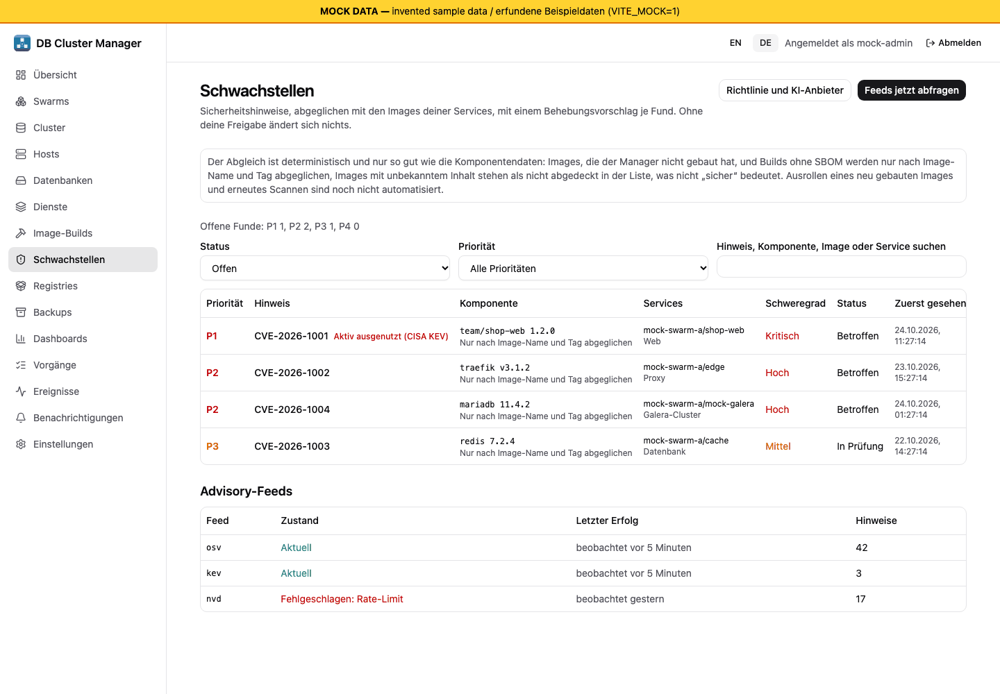
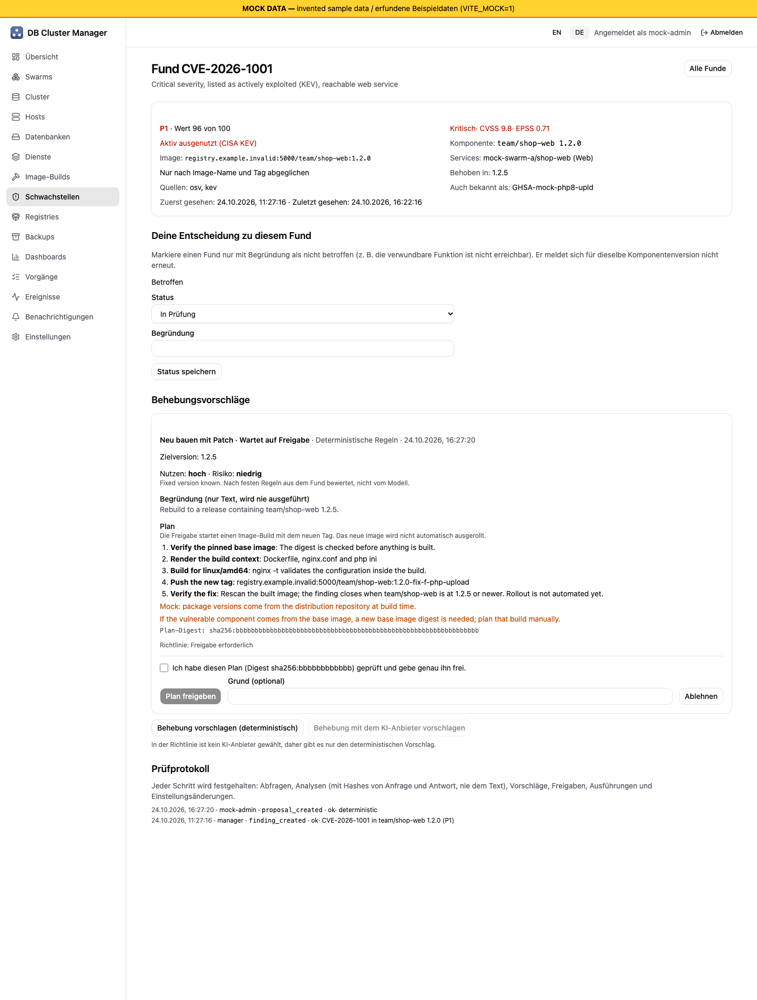
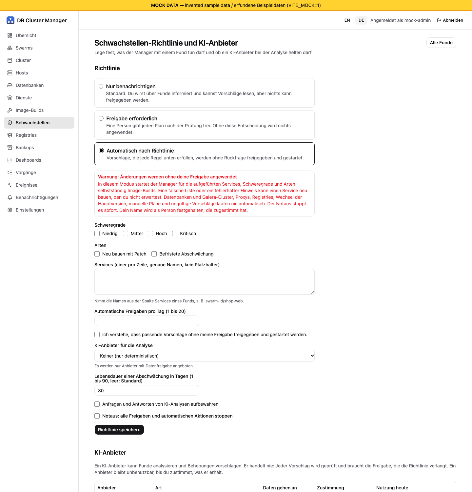
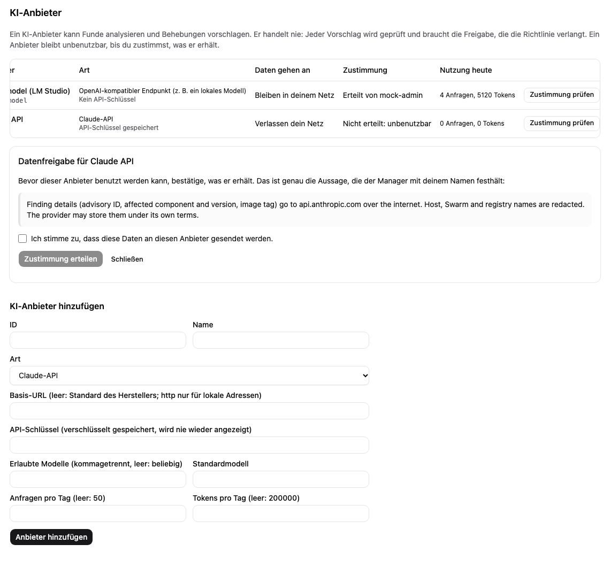

# Reaktion auf Schwachstellen

[Handbuch-Index](index.md) | Zurück: [Dienste](13-services.md)

**Status: verdrahtet, nur mit Fakes getestet.** Das Backend (`internal/vuln`, `internal/ai`, die Routen `/api/v1/vuln/*`) ist im Manager verdrahtet, wenn `manager.vuln` konfiguriert ist (Zeitplan zum Abfragen nur auf dem Leader, ein Inventar aus den eigenen Service-, Cluster- und Image-Build-Datensätzen des Managers, Benachrichtigungen über den Dispatcher, verschlüsselte Anbieter-Schlüssel, Budgets und Audit-Reihenfolge im Metastore) und hat eine Weboberfläche (Seite Schwachstellen, Fund-Detail, Richtlinie und KI-Anbieter). Alles wurde gegen `httptest`-Fixtures, Fakes und einen Mock-Server getestet: Es hat nie einen echten Advisory-Feed abgefragt, nie einen echten KI-Anbieter aufgerufen und nie etwas gebaut, gepusht oder ausgerollt, und die Oberfläche wurde nie gegen einen echten Manager benutzt. Entwurf und offene Entscheidungen stehen in [ADR 0015](../../decisions/0015-ai-assisted-vulnerability-response.md). Nicht darauf verlassen.

## Weboberfläche

Menüeintrag **Schwachstellen** (nur Administrator; andere Rollen erhalten „verboten“). Die Screenshots stammen vom Mock-Server der Entwicklung mit erfundenen Daten; sie zeigen die Oberfläche, kein geprüftes Verhalten.

- **Funde** mit Priorität, Hinweis, Komponente, Services, Schweregrad und Status; Filter nach Status und Priorität, Freitextsuche, eine Schaltfläche zum sofortigen Abfragen der Feeds und der Zustand jedes Feeds (aktuell, veraltet, fehlgeschlagen mit grober Ursache). Images mit Abdeckung nur über die Referenz sagen das; Images mit unbekanntem Inhalt werden nach einer Feed-Abfrage als nicht abgedeckt genannt.
- **Fund-Detail** mit Schweregrad, CVSS, KEV- und EPSS-Eingaben, behobenen Versionen und Quellen, deiner eigenen Entscheidung (in Prüfung, nicht betroffen mit Begründung, betroffen), den Behebungsvorschlägen und dem Prüfprotokoll dieses Funds. Jeder Vorschlag zeigt Art, Herkunft (deterministisch oder KI mit Anbieter und Modell), Nutzen-/Risiko-Bewertung, Planschritte und Warnungen, den Plan-Digest, Fehler des Prüfers und was das Modell gesagt hat (nur zur Information). **Plan freigeben** braucht die Bestätigung genau dieses Digests; **Ablehnen** nimmt einen optionalen Grund. Die Schaltfläche erklärt, warum sie gesperrt ist (Richtlinie „nur benachrichtigen“, Notaus, ungültiger oder bereits entschiedener Vorschlag).

- **Richtlinie und KI-Anbieter** (Seite „Richtlinie und KI-Anbieter“): der Modus mit Erklärung, für `auto_for_policy` eine deutliche Warnung, die Erlaubnisliste (Schweregrade, genaue Servicenamen, Arten, Tageslimit) und eine Bestätigung, dass passende Vorschläge ohne Freigabe laufen. Notaus, Lebensdauer von Abschwächungen sowie Anbieter und Modell für Analysen (angeboten werden nur Anbieter mit Zustimmung).

- **Anbieter und Zustimmung:** Anbieter hinzufügen (gehostete Arten brauchen einen API-Schlüssel, der einmal gesendet und nie wieder angezeigt wird; CLI-Arten brauchen die Bestätigung „experimentell“); jeder Anbieter zeigt, ob Daten dein Netz verlassen, seine Zustimmung und die heutige Nutzung. Der Zustimmungsschritt zeigt die genaue Aussage zur Datenweitergabe; das Erteilen braucht die Bestätigung und sendet diese Aussage unverändert.

## Konfiguration

`manager.vuln` in der Manager-Konfiguration (braucht `auth.enabled`; siehe [Konfigurationsreferenz](12-configuration-reference.md#reaktion-auf-schwachstellen)). Ohne sie antworten die Routen mit 503 und nichts wird abgefragt. Mit leerem `"vuln": {}` läuft der Dienst, die Richtlinie ist `notify_only`, kein Feed ist konfiguriert, kein Anbieter existiert und nichts greift auf das Netz zu.

## Was es tut

1. **Inventar.** Jedes dem Manager bekannte Image ist ein Inventareintrag mit seinen Diensten, einer Dienstart (Web, generisch, Datenbank, Galera, Proxy, Registry) und einer Abdeckungsangabe: `sbom` (Komponentenliste bekannt), `reference` (nur Image-Name und Tag, abgeglichen als Ökosystem `docker`) oder `unknown`. Unbekannte Einträge werden als nicht abgedeckt gemeldet, nie als sicher. Der Manager baut das Inventar aus seinen eigenen Datensätzen: Images von Container- und Traefik-Services und von Galera-Clustern, gruppiert nach Image-Referenz, wobei die Dienstart aus Typ und Image-Name geschätzt wird (Datenbank-Images am Namen wie mariadb, redis oder postgres; Proxy für Traefik). Ein vom Manager gebautes Image wird mit seinem Build-Datensatz (Spezifikation und Registry-Ziel) verknüpft, damit ein Neubau geplant werden kann. Beim Bauen wird noch keine SBOM erzeugt; die Abdeckung ist daher `reference` für Images mit Tag und `unknown` für reine Digest-Referenzen. **[Fakes]**: nur gegen Fake-Datensätze getestet.
2. **Feeds.** Adapter für OSV (`POST /v1/query` je Komponente), die globale GitHub-Advisory-API (geprüfte Advisories, `Link`-Paginierung nur auf demselben Host, ETag), die NVD-CVE-API 2.0 (Änderungsfenster höchstens 120 Tage, CPE-Treffer, `cisaExploitAdd` als KEV), den CISA-KEV-Katalog und eine Offline-Spiegeldatei (OSV-JSON-Array) für Umgebungen ohne Internet. Kein Feed hat eine Standard-URL; ohne Konfiguration geht nichts ins Netz. Antworten sind begrenzt (32 MiB), Ratenbegrenzungen führen zu Wartezeiten (Retry-After oder 5 Minuten, verdoppelt bis 6 Stunden), und ein Feed ohne Erfolg seit 24 Stunden wird als veraltet angezeigt. Feeds werden mit ausdrücklichen URLs in `manager.vuln.feeds` aufgelistet. **[Fakes]**: nur gegen Fixtures im dokumentierten Format getestet.
3. **Abgleich.** Ein deterministischer Abgleich vergleicht Ökosystem, Paketname und Versionsbereiche (ohne KI). Einträge derselben Schwachstelle aus mehreren Feeds werden unter der CVE-ID zusammengeführt (Deduplizierung) und im replizierten Metastore gespeichert. Der Versionsvergleich folgt den Debian-Regeln mit Behandlung von semver- und Alpine-Vorabversionen; PEP 440, Maven und RPM sind nicht gesondert umgesetzt. **[Fakes]**
4. **Befunde.** Jeder Treffer ist ein Befund mit Schweregrad, CVSS, KEV-Listung, EPSS-Wahrscheinlichkeit und einer deterministischen Priorität (P1-P4, die Herleitung wird angezeigt). Der Status ist VEX-artig: `affected`, `under_investigation`, `not_affected` (Begründung nötig; meldet sich für diese Komponentenversion nicht erneut), `fixed` (automatisch, wenn das Inventar nicht mehr passt; ein Zurückrollen öffnet ihn wieder). **[Fakes]**
5. **Vorschläge.** Für einen offenen Befund lässt sich ein Vorschlag anfordern, deterministisch oder KI-gestützt (unten). Ein Vorschlag ist einer von: **gepatchter Neubau** (auf eine im Advisory genannte behobene Version), **Abschwächung** (eine `php.ini`-Einstellung aus der Positivliste, befristet, standardmäßig 30 Tage) oder **keine Änderung** (Entscheidung festhalten). Jeder Vorschlag hat eine deterministische Nutzen-/Risikobewertung und einen Plan mit Digest; ein Vorschlag, der die Prüfung nicht besteht, wird als `invalid` mit den Gründen gespeichert und kann nie freigegeben werden. **[Fakes]**
6. **Freigabe und Ausführung.** Die Freigabe ist an den Plan-Digest gebunden und berechnet den Plan aus dem aktuellen Inventar neu; eine geänderte Zusammenstellung macht sie ungültig. Der einzige Ausführende startet einen Image-Build über den Image-Build-Dienst (selbst [Fakes]); das Ausrollen auf Dienste ist nicht umgesetzt. Ohne vom Manager gebaute Zusammenstellung ist der Plan manuell, und die Freigabe hält nur die Entscheidung fest. **[Fakes]**

## Richtlinienmodi

| Modus | Verhalten |
| --- | --- |
| `notify_only` (Standard) | Befunde und Vorschläge werden angezeigt und gemeldet. Nichts kann freigegeben oder ausgeführt werden. |
| `approval_required` | Vorschläge warten auf die digestgebundene Freigabe durch einen Administrator. |
| `auto_for_policy` | Ausdrückliches Opt-in (protokolliert). Ein Vorschlag wird nur automatisch freigegeben, wenn Schweregrad, jeder betroffene Dienst (namentlich, kein Platzhalter) und Art (`patched_rebuild` oder `mitigation`) in der Positivliste stehen und das Tageslimit (1-20) nicht erreicht ist. Alles andere wartet auf Freigabe. |

Nie automatisch, in jedem Modus: Datenbank- und Galera-Dienste, Proxy- und Registry-Dienste, Major-Upgrades, Pläne ohne automatisierten Schritt, Vorschläge ohne Änderung und alles, was die Prüfung abgelehnt hat. Ein Not-Aus stoppt alle automatischen Freigaben.

## KI-Anbieter (optional)

Arten: `claude_api`, `openai_api`, `openai_compatible` (LM Studio, Ollama und ähnliche; unverschlüsseltes http nur zu Loopback- oder privaten Adressen) und die experimentellen CLI-Logins `claude_code_cli` und `codex_cli`. Die Richtlinie wählt einen Anbieter und ein Modell; die Modellliste des Anbieters begrenzt die Auswahl.

- **Zuerst Zustimmung.** Ein neuer Anbieter ist unbenutzbar, bis ein Administrator seiner Erklärung zum Datenabfluss (was an wen gesendet wird) zustimmt. Die Zustimmung wird protokolliert und ist widerrufbar.
- **Was gesendet wird.** Nur Advisory-ID und Aliasse, Schweregrad, Zusammenfassung und Details des Advisorys, Ökosystem, Name und Version des Pakets, genannte behobene Versionen, Image-Name und Tag ohne Registry-Host, Dienstart, die erlaubten Einstellungsnamen und die aktuellen Werte erlaubter Einstellungen. Aller Freitext durchläuft die Schwärzung (private Schlüssel, Cloud- und API-Token, Bearer-Token, Verbindungszeichenfolgen, Zugangsdaten in URLs, Werte wie `password=`, E-Mail- und IP-Adressen sowie die konfigurierten Umgebungsnamen). Ein Image-Name, der noch einen Umgebungsnamen enthält, wird abgewiesen.
- **Prompt-Injection.** Advisory-Text steht in einem Datenblock zwischen zufälligen Begrenzungszeilen und ist als nicht vertrauenswürdig gekennzeichnet. Das Modell hat keine Werkzeuge. Seine Antwort muss genau ein JSON-Objekt nach einem strikten Schema sein (keine unbekannten oder doppelten Felder, Aufzählungswerte, einzeilige Einstellungswerte); alles andere macht den Vorschlag ungültig. Gültige Antworten werden trotzdem geprüft: Die Komponente muss die des Befunds sein, eine Zielversion muss im Advisory als behoben genannt sein und außerhalb aller betroffenen Bereiche liegen, eine Einstellung muss in der Positivliste stehen und ihr Wert die Prüfungen des Image-Builds bestehen. Die Begründung wird nur angezeigt.
- **CLI-Logins.** Laufen als Unterprozess ohne Shell: absoluter Binärpfad, als Umgebung nur `PATH`, `LANG`, `NO_COLOR` und das konfigurierte `HOME`, ein leeres temporäres Arbeitsverzeichnis, ein Zeitlimit und Ausgabegrenzen. Claude Code läuft mit `--tools ""` und `--strict-mcp-config`, Codex mit `--sandbox read-only`. Die Optionen stammen aus der lokalen `--help`-Ausgabe und liefen nie gegen einen echten Login. Ob die unbeaufsichtigte Nutzung eines persönlichen Logins erlaubt ist, ist offen; die Bestätigung `experimental` ist Pflicht.

  **Warnung:** CLI-Anbieter brauchen ausdrücklich `manager.vuln.allowCLIProviders: true` (Standard: false); Konfiguration und Ausführung werden sonst abgelehnt. Sie laufen mit den Rechten des Manager-Prozesses. **Nicht im Standard-Stack mit eingebundenem Docker-Socket verwenden.** CLI-Optionen und temporäres Arbeitsverzeichnis nehmen diese Rechte nicht weg.
- **Zugangsdaten.** API-Schlüssel werden einmal angenommen, mit dem Datenschlüsselbund versiegelt gespeichert (`manager.SealedSecretStore`, [Fakes]) und nie zurückgegeben, protokolliert oder anderswohin gesendet als in den Authentifizierungs-Header des Anbieters. Weiterleitungen des Anbieters werden nicht befolgt.
- **Grenzen.** Je Anbieter und UTC-Tag standardmäßig 50 Anfragen und 200 000 Token. An der Grenze wird die Analyse abgelehnt (409 `busy`), der deterministische Vorschlag funktioniert weiter. Die Zähler liegen im Metastore und überstehen Neustart und Leader-Wechsel.

Die Eignung irgendeines Modells für diese Aufgabe, lokal oder entfernt, ist nicht gemessen.

## Protokoll

Jeder Schritt wird festgehalten: Abfragen, neue und erledigte Befunde, Statusentscheidungen, Analysen (Anbieter, Modell, SHA-256 von Prompt und Antwort, Zahl der Schwärzungen, Token-Verbrauch), Vorschläge und Prüfergebnisse, Freigaben (manuell und automatisch), Ablehnungen, Ausführungen, Richtlinienänderungen, Anbieterregistrierung und Zustimmung. Prompts und Geheimnisse werden nie protokolliert.

## API

Alle Routen brauchen eine Berechtigung auf die Ressource `vuln`, die außer dem Administrator keine Voreinstellungsrolle hat. Lesen: `GET /vuln/findings`, `/vuln/findings/{id}`, `/vuln/proposals`, `/vuln/feeds`, `/vuln/policy`, `/vuln/providers`, `/vuln/audit`. Bedienen (operate): `POST /vuln/poll`, `POST /vuln/findings/{id}/proposals`. Ändern (update): `PUT /vuln/findings/{id}/status`, `POST /vuln/proposals/{id}/approve`, `POST /vuln/proposals/{id}/decline`, `PUT /vuln/policy`, `PUT /vuln/providers/{id}/consent`. Anlegen (create): `POST /vuln/providers`. Details: [api/openapi.yaml](../../../api/openapi.yaml). Die Einstellungen stehen in der [Konfigurationsreferenz](12-configuration-reference.md#reaktion-auf-schwachstellen-api-einstellungen).

## Grenzen

Es wurde kein echter Feed, keine echte KI-Anfrage, kein Build und kein Ausrollen ausgeführt. Die Inventarabdeckung beruht nur auf Image-Name und Tag (keine SBOM beim Bauen), die Dienstart ist eine Schätzung aus Image-Namen, es gibt keinen erneuten Scan, kein Ausrollen, kein Canary oder Zurückrollen, kein Entfernen von Abschwächungen nach einem Patch, keine Aufbewahrung von Prompts und keinen kuratierten Katalog von Abschwächungen. Die Oberfläche wurde nur mit Unit-Tests, `svelte-check` und dem Mock-Server geprüft. Siehe [Bekannte Grenzen](10-known-limits.md) und [STATUS.md](../../STATUS.md).

## Globale Audit-Seite

Auf der Befundseite **Prüfprotokoll** öffnen, um den globalen Verlauf einschließlich
Feed-Abfragen, Richtlinienänderungen und Anbieterfreigaben ohne Befundbezug zu
sehen. Die Suche umfasst Akteur, Ereignis, Ergebnis und Referenzen. Einträge
stehen nach absteigender bestätigter Audit-Sequenz; Befundreferenzen öffnen die
bestehende Detailseite. Ereigniscodes, Details und Ergebnisse bleiben der
aufgezeichnete Backend-Text. Lesefehler zeigen eine Wiederholungsmöglichkeit
statt eines leeren Verlaufs. Die Oberfläche ergänzt keine APIs für Seitennavigation,
Aufbewahrung oder Export des Audits.
