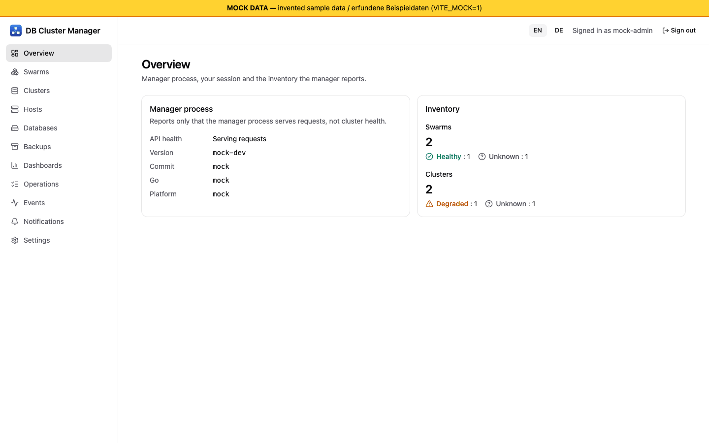

# Getting started and installation

[Guide index](index.md) | Next: [Enrolling hosts and agents](02-hosts-and-agents.md)

## What you get today

The manager is one Go binary that serves the web UI and the HTTP API (`/api/v1`). It can run in three modes:

| Mode | What works | Level |
| --- | --- | --- |
| Prototype (no `-config`) | UI, `GET /api/v1/health`, `GET /api/v1/version`. No state, no Docker. | Served on the developer host over loopback (W02); no container or VM run. |
| Auth mode (`auth.enabled`, no `manager` section) | Setup, passkey login, recovery, roles, audit to the log. State is **in memory** and lost on restart; resource endpoints answer 503. | [Fakes] (software authenticator) |
| Managed mode (`manager` section) | Replicated store, Swarm connection, agent deployment, cluster operations, backups, monitoring. | [Lab VMs] as a single instance run as a process on a Swarm manager node (E4-E6). |

*Screenshot from the development mock server (`npm run dev:mock`, invented sample data), not from a real manager.*

## Requirements

- A Docker Swarm (E4-E6 used Docker 29.9.2 on Ubuntu 26.04, arm64). The compatibility matrix is seeded only with Docker 29.x. amd64 has **no** evidence yet [Untested].
- A TLS reverse proxy in front of the manager. Passkeys (WebAuthn) require an HTTPS origin whose host is the configured `rpId`; plain `http://localhost` is accepted for development only. The manager itself has no TLS for its UI/API.
- One Swarm manager node to pin the manager to. `deploy/stack.yaml` mounts `/var/run/docker.sock` there, which is root-equivalent on that node; the manager runs as uid 65532 with the socket's group, read-only and without capabilities ([ADR 0014](../../decisions/0014-manager-container-docker-access.md)). Do not mount the socket into anything else.

## Install the manager

Technical details and the packaging status are in [INSTALL.md](../../INSTALL.md). Summary:

1. Obtain an image. No release exists yet; build it locally from the repository root (use a dedicated test environment and an explicit Docker context): `docker buildx build -f deploy/Dockerfile -t db-cluster-manager:local --build-arg VERSION=0.0.0-dev --load .` The image was **never built** by the project [Untested]; lab E4 built the equivalent runtime stage inside a VM.
2. Create the configuration: `manager init -rp-id <UI host name> -manager-addr <address of the manager node> -out manager.json`. It writes a JSON configuration without secret values (only Swarm secret names) and prints the remaining steps: host directories, secrets and networks to create, the deploy command and where the setup token appears. `-backup -recovery-key-out <file>` also configures backups with a newly generated recovery key. Field names are documented in the header comment of `cmd/manager/main.go`; unknown fields are rejected. The command is covered by tests only [Fakes].
3. Store it as a Swarm config (`docker config create dbcm-manager-config-1 manager.json`) and deploy: `DBCM_MANAGER_NODE=<node hostname> DBCM_DOCKER_GID=$(stat -c %g /var/run/docker.sock) DBCM_CONFIG_NAME=dbcm-manager-config-1 docker stack deploy -c deploy/stack.yaml dbcm` [Untested]. The stack runs **one** replica pinned to that node (its data volume exists only there), on the host network with the API on `127.0.0.1:8080` for your TLS reverse proxy. `deploy/compose.yaml` is the single-host variant. E4 ran the same configuration as a transient systemd unit on a Swarm manager node, not as a container.

### Highly available manager

Three replicas need three separately pinned services with their own configurations, keyring and metastore peer certificates; [INSTALL.md](../../INSTALL.md) ("Three-replica variant") describes the layout. It is not shipped as a file and has never run [Untested]. A replicated metastore with several replicas was proven only as the `metad` lab harness (E3) and as library code.

## First run: setup token and first passkey

1. Start the manager with auth enabled. On start it prints one line to stderr (container: `docker logs`): `First-run setup token (valid until the first administrator is created): <token>`. In managed mode the token is printed only while no administrator exists.
2. Open the UI over your HTTPS URL. The setup page asks for the token, an account ID and a passkey label, then runs the browser's passkey registration.
3. After the registration the first administrator is created, setup is disabled for good, a session starts and **ten recovery codes are shown exactly once**. Store them offline (password manager or printed). Only hashes are kept.
4. Log in later with the passkey. Further passkeys can be registered from the account (`/auth/passkeys/*`).

Verification: the API flow ran on lab VMs with a software ES256 authenticator (account created, 10 codes, session, `setupRequired: false`) [Lab VMs]. The UI flow ran once in headless Chromium with a virtual authenticator [Fakes]. A real hardware authenticator, a platform passkey, Safari/Firefox and screen readers were **not** tested [Untested]. Wrong setup tokens are rate limited per client IP.

If the setup token was lost: restart the manager (a new token is printed while no administrator exists). If all passkeys are lost, see [Security model](08-security-model.md) for recovery codes.

## Next steps

Connect a Swarm and enroll hosts: [Enrolling hosts and agents](02-hosts-and-agents.md). Before relying on anything, read [Known limits](10-known-limits.md).
