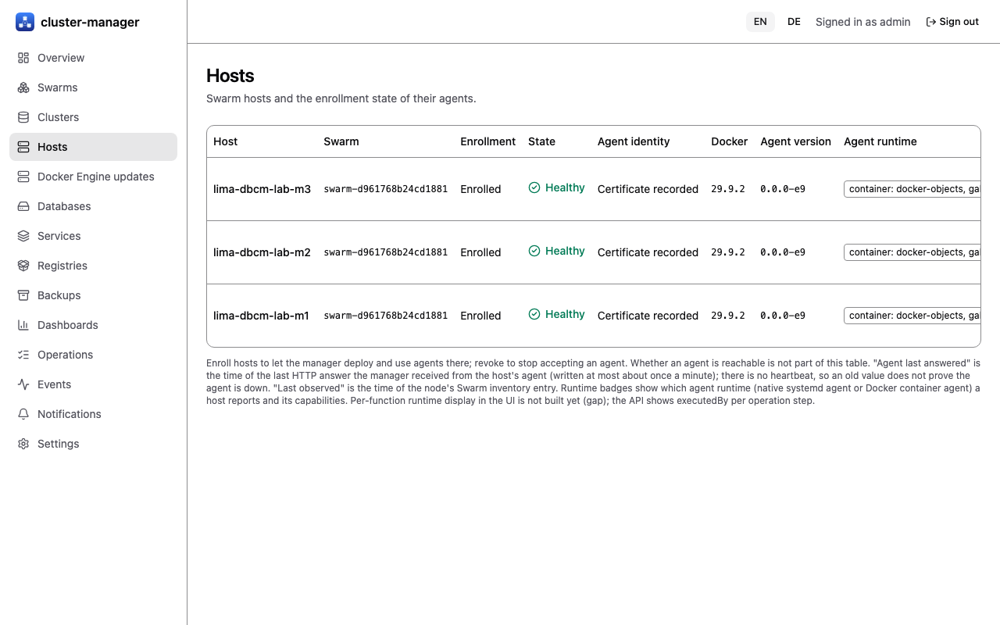

# Enrolling hosts and agents

[Guide index](index.md) | Previous: [Getting started](01-getting-started.md) | Next: [Creating a Galera cluster](03-create-cluster.md)

The manager never runs commands on hosts by itself. A small **agent** runs on each enrolled host as a manager-deployed Swarm global service and executes fenced, allow-listed commands (create volume, start database service, read `grastate.dat`, and so on). The agent only touches objects the installation created (ownership label allow-list).

## Connect a Swarm

`POST /api/v1/swarms` with the Docker endpoint (E4: `unix:///var/run/docker.sock` on a Swarm manager node), then `POST /api/v1/swarms/{id}/sync`. The Swarm shows state `healthy`, and `GET /api/v1/hosts` lists nodes with roles, CPUs, memory and Docker version [Lab VMs] (3 nodes). Connecting to a remote, mutually authenticated Docker API is an open design item (P04) [Untested]. A Docker version outside the compatibility matrix (only Docker 29.x seeded) is flagged [Fakes].

The **Hosts** page shows, per host, the agent version and when the manager last received an HTTP answer from that agent (`agentVersion`, `agentSeenAt` in `GET /api/v1/hosts`) [Fakes]. The manager records both whenever it talks to the agent, at most about once a minute. There is no heartbeat: an old or missing value does not prove the agent is down, and a host the manager never contacted shows "not contacted yet". "Last observed" remains the time of the Swarm inventory entry.

## Prerequisites you must create yourself

The manager does not create or check these yet. Missing items give confusing failures (see [Troubleshooting](09-troubleshooting.md)).

- On **every** host: the directories `/var/lib/dbcm-agent` and the configured volume base (for example `/var/lib/dbcm/volumes`). Swarm rejects the agent task otherwise (`bind source path does not exist`).
- At least one enrolled **Swarm manager node** with an agent: workers cannot change services, so service and job commands go to a manager node's agent.
- Images present on every node (a registry, or `docker save | docker load` as in the lab). Images are referenced by tag or digest.
- The manager `settings` (installation ID, volume base, agent image, accounts, backup settings). Without them most commands answer `409 settings_incomplete`.
- Per cluster: an attachable overlay network and the root, monitoring and backup password secrets, all with the label `dbcm.installation=<installation ID>`.

## Enroll hosts

1. `POST /api/v1/hosts/{id}/enroll` for each host (`id` is the Swarm node ID). Needs host update permission; audited. The UI host page does the same.
2. `POST /api/v1/swarms/{id}/agents/deploy` creates the agent global service if needed and sets the enrollment label per host. The response lists `labeled`, `unlabeled` and `failed` hosts.
3. Each agent enrolls itself: a one-time token delivered as a Swarm secret, pinning of the CA fingerprint, a certificate signing request, and a check of the source address. Afterwards the manager talks to the agent over **mTLS 1.3**.

Observed: three agents enrolled within 2 s and reported `agentIdentity: true` [Lab VMs]. The UI host page was only run against fakes [Fakes].

*Screenshot from the development mock server (`npm run dev:mock`, invented sample data), not from a real manager.*

## Revoke a host

`POST /api/v1/hosts/{id}/revoke` marks the host revoked and revokes the agent certificate. The leader now pushes the replicated deny list (revoked and superseded agent certificates, revoked manager certificates) to every enrolled agent with the command `set-deny-list`; the agent stores it and its mTLS listener refuses denied certificates. An end-to-end test on loopback (enrollment, renewal, distribution, a revoked manager certificate refused in the TLS handshake) passed [Fakes]. The path with a real agent on VMs and certificate renewal there were **not** exercised [Untested]. Deny-list entries are never pruned.

To cut off a manager replica, `POST /api/v1/settings/replicas/{id}/revoke-certificates` (settings update permission, audited, leader only) denies all its unexpired manager certificates; a replica still in service gets fresh ones on next use [Fakes].

## Rotating secrets

Adding a new database secret to the agents requires an agent service update. Not exercised [Untested].
