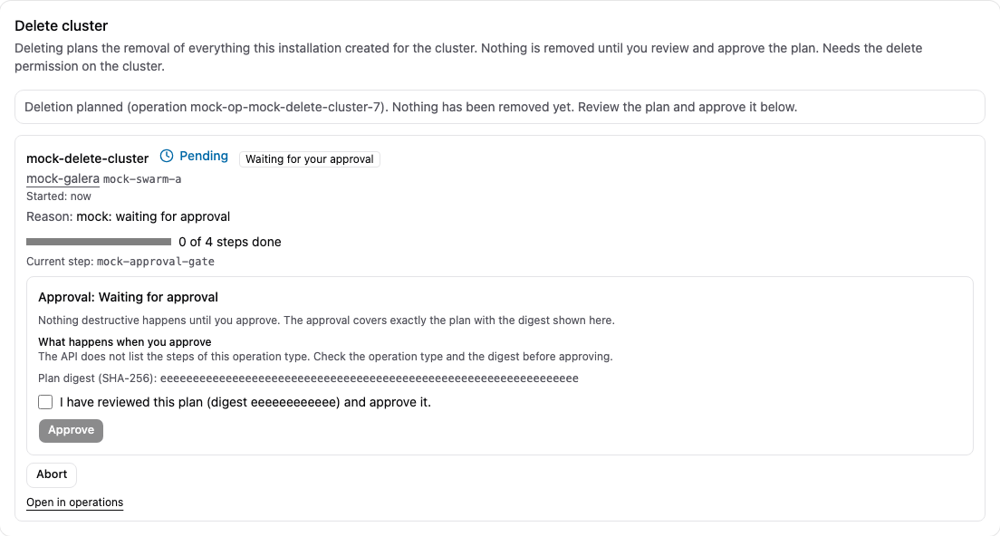

# Creating a Galera cluster

[Guide index](index.md) | Previous: [Enrolling hosts](02-hosts-and-agents.md) | Next: [Health and alerts](04-health-alerts.md)

## Request

`POST /api/v1/clusters` (or the UI cluster wizard). Required fields: `swarm`, `name` (lowercase letters, digits, hyphens, at most 48 characters), `size` (**3 or 5**), `image` (MariaDB image; a tag such as `mariadb:11.4.13` works, a digest is recommended beyond a trial; the image must be on every node), `network` (existing attachable overlay), `rootPasswordSecret` (name of an existing Swarm secret, never the password), `resources.limits` and `resources.reservations`, and `placement` (allow list, exclusion, preference, `reserve`). Optional: `gcacheSize`, `autoReplace`, `binlog` (the wizard's checkbox "Binary log (point-in-time recovery)": every node writes the binary log; it cannot be switched on later and is required for [point-in-time recovery](05-backup-restore.md)). In the wizard the step "Resources" needs a CPU and a memory limit or reservation; without them the preflight stops with "Set a CPU and a memory limit". A three-node cluster with the binary log, 1 CPU / 1 GiB per node, reached 23 of 23 steps in about two minutes on 2-vCPU / 4-GiB lab VMs [Lab VMs, E16].

Placement precedence is allow list, exclusion, preference, then automatic scoring; allow-listing and excluding the same host is `policy_conflict`. Other coarse errors: `no_capacity`, `settings_incomplete`, `cluster_exists`. The response is an operation (`202`); watch it with `GET /api/v1/operations` (progress shows the current step, attempts and the latest unmet precondition).

*Real screenshot: the UI against a real manager on lab VMs (2026-10-30).*

## What the operation does

One pinned Swarm service per node, each with its own local volume and an identity marker; the bootstrap node starts first, the others join one at a time; the monitoring account (`dbcm_monitor`) and backup account (`dbcm_backup`) are created and replicate. A node never starts on an empty volume that lacks the marker (the E2 "empty-volume trap" guard).

## Verification

| Part | Level |
| --- | --- |
| 3-node MariaDB 11.4 cluster through the manager API: operation `succeeded` in about 80 s, all nodes `Synced`, size 3, same state UUID, writes on n1/n3 readable everywhere, SST by mariabackup over the relocated socket | [Lab VMs] (E4, once from scratch; host carried foreign load, timings only conditional) |
| Pinned services, host loss and return, minority partition, marker guard | [Lab VMs] (E1/E2, scripts, not through the manager) |
| 5-node clusters | [Untested] |
| Capacity planning, `no_capacity`, resource exhaustion | [Fakes] |
| Wizard UI | [Fakes] (headless browser, fake API) |
| amd64 | [Untested] |

## Failed create and deletion

An aborted create (`POST /api/v1/operations/{id}/abort`) ends in the state `aborted`; its reason starts with `aborted at a safe boundary` and names steps whose outcome is unknown. A failed or aborted create keeps the cluster name and planned capacity until you delete it. `DELETE /api/v1/clusters/{id}` plans a `cluster/delete` operation and returns an approval digest; nothing is removed before `POST /api/v1/operations/{id}/approve` with that digest. It needs the **delete** permission (administrator preset only). Deletion removes only objects the installation created (database services, unfinished job services, inspection instances, node volumes after the identity check). Operator networks and secrets, host directories of local volumes and backups in the backend are kept. This path ran only against fakes [Fakes]; the E4 failed-create cleanup was done by hand.

*Screenshot from the development mock server (`npm run dev:mock`, invented sample data), not from a real manager.*

## After creation

- Endpoints are shown as `<cluster>-nN:3306` inside the overlay network. A client-facing endpoint requires the database proxy, which the manager does not deploy yet; see [Known limits](10-known-limits.md). The `cmd/proxy` binary ran in front of the lab cluster (writer selection, failover, TLS termination) [Lab VMs] (E5), started as a lab container by hand.
- Database, user and grant management exist as SQL generation only [Fakes].
