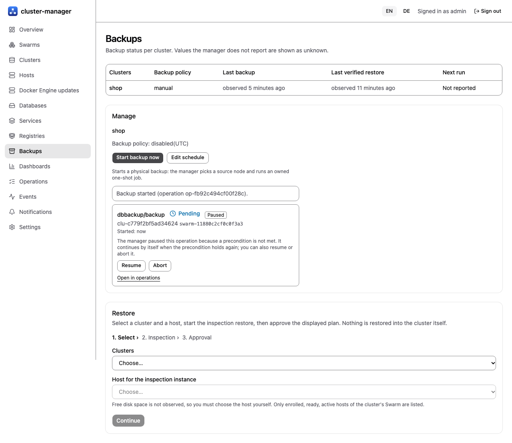
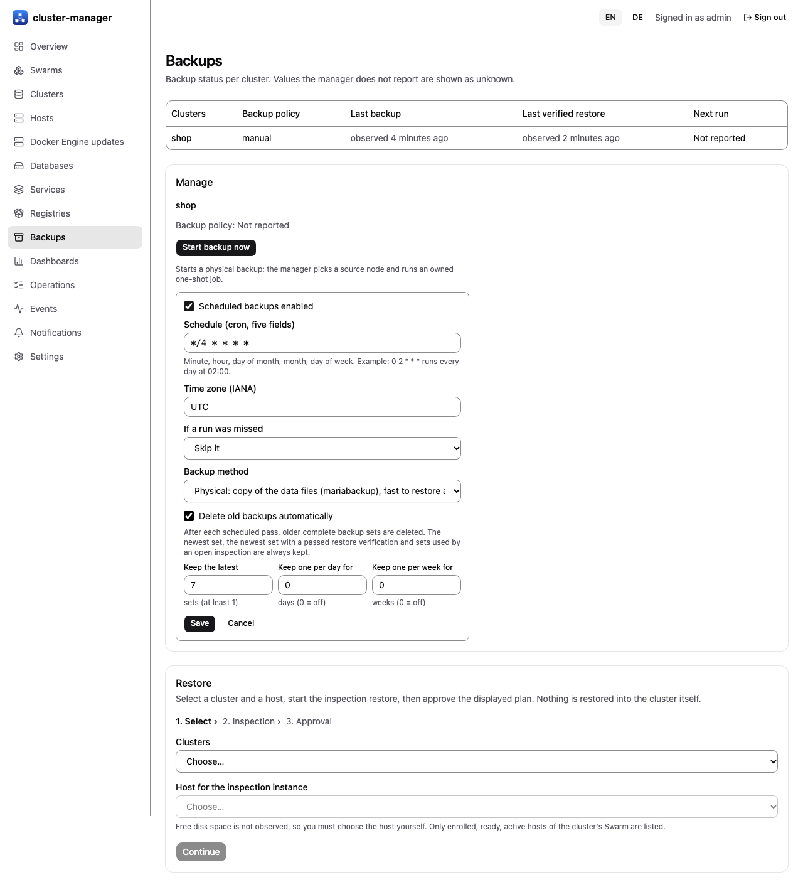
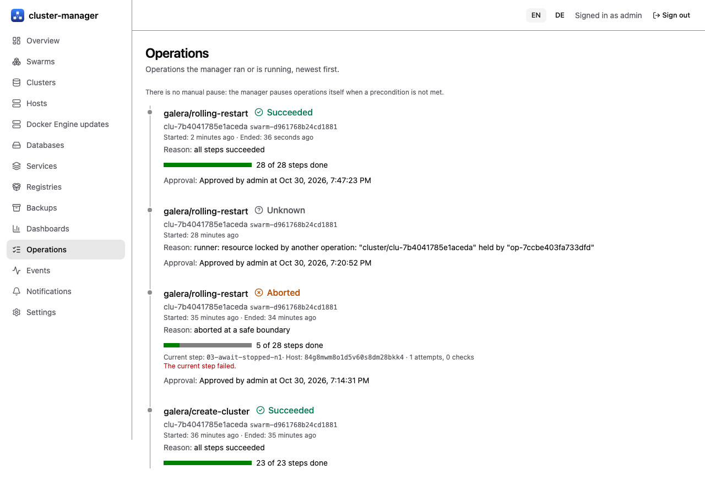

# Backups and restore

[Guide index](index.md) | Previous: [Health and alerts](04-health-alerts.md) | Next: [Node replacement](06-node-replacement.md)

## Concepts

- **Cluster backup:** a physical backup (`mariabackup`) streamed, encrypted, to an S3 or SFTP backend by a one-shot Swarm job service (job image `deploy/Dockerfile.jobs`, `mariadb:11.4.13` plus `dbcm-job`). A **logical** backup (one `mariadb-dump` export per named database) is available as a method; it needs `accounts.backupLogical` in the settings so the backup account has the read privileges.
- **Manager configuration backup** is a separate library feature (see below).
- **Inspection restore:** the backup is restored into an isolated single-node instance (`--wsrep-on=OFF`, own network, own port, no replication, no binary log) so you can look at data. It never joins the production cluster.

## Prerequisites

Backend settings (`manager.backup.backendConfigFile`), a recovery-key Swarm secret, a backup option file secret, the job image on the relevant nodes, and an inspection network. The lab used SFTP with a dedicated user and a pinned host key. The `dir` backend does not work with jobs (the job writes inside its own container).

## Start a backup and set a schedule

- Now: `POST /api/v1/clusters/{id}/backups` (permission: backup on the cluster). The manager picks an eligible source node and creates an owned job pinned to that host.
- Schedule: `PUT /api/v1/clusters/{id}/backup-policy` with `enabled`, a five-field cron-like `schedule`, `timezone`, `missed` (`skip` or `run-once`), `method: physical` or `logical` (logical needs `databases`, at most 64), and an optional `retention` with `keepLast` (1-1000), `keepDaily` and `keepWeekly`. A manual logical backup is `POST /api/v1/clusters/{id}/backups` with `{"method": "logical", "databases": ["app"]}`. `GET /api/v1/backups` lists `lastBackupAt`, `nextRunAt`, `lastVerifiedRestoreAt`; absent means unknown, not "none".

*Real screenshot: the UI against a real manager on lab VMs (E14, 2026-10-30).*

## Retention

After each scheduler pass the manager deletes older complete backup sets according to the policy (manifest first, then stream). It always keeps the newest set, the newest set with a passed restore verification and sets used by an open inspection, and skips a cluster while one of its operations is unfinished. [Fakes]: an end-to-end test over four simulated days with fake jobs and an in-memory backend; no deletion ran against a real SFTP or S3 backend.

In the schedule form you choose the method (physical, or logical with the databases to export) and optional retention (keep the latest N sets, one per day for N days, one per week for N weeks). The form states that the newest set, the newest verified set and sets used by an open inspection are always kept.

*Real screenshot: the UI against a real manager on lab VMs (E14, 2026-10-30).*

## Restore with inspection and approval

1. `POST /api/v1/restores/inspect` with `cluster`, optional `backup` (default: newest completed), `host`, `keySecret`, `ttlMinutes` (at most 1440). The response contains the **approval digest** and, only once, the inspection account password.
2. Review the plan, then `POST /api/v1/operations/{id}/approve` with the digest. A wrong digest answers `409 approval_mismatch`. Approval needs the **restore** permission (administrators; not in the operator preset).
3. The job restores, the instance starts, and you connect with the one-time `dbcm_inspect` account. At expiry the instance, its volume and its init secret are removed.

*Real screenshot: the UI against a real manager on lab VMs (2026-10-30).*

## Verification levels

| Part | Level |
| --- | --- |
| Stage 3 on a three-node Galera cluster (E14): physical backup to **S3 (MinIO, TLS, private CA)** through the UI and the scheduler, inspection restore with approval through the UI (200,000 + 1,000 rows, identical `CHECKSUM TABLE`), scheduled restore verification, retention (`keepLast`), copy to a second target with digest check, restore proposal; failure cases wrong credentials, unreachable target and full target | [Lab VMs] ([results](../../../tests/p0/results/e14-backup-restore.md)) |
| Physical backup to SFTP on a worker-hosted source (about 15 s, 55.7 MB stream, manifest with checkpoints) | [Lab VMs] (E4) |
| Inspection restore with approval digest, wrong digest `409`, restored rows readable, `wsrep_on 0` | [Lab VMs] (E4, on the manager node's host) |
| Restore and inspection jobs on worker hosts (job on the manager node's agent, check of the target host) | [Fakes] |
| Restore verification gate, instance-level report, `lastVerifiedRestoreAt`, teardown with secret removal | [Fakes]; table contents are not compared even in the design |
| Galera position in the manifest read from the stream | [Fakes]; unconfirmed assumption for MariaDB 11.4 |
| Backup scheduler, retention and S3 backend | [Lab VMs] (E14) |
| Logical backup (manual and scheduled), restore into a **new cluster** | [Fakes]; the restore of a copy ends at the proposal (not executed through the API) |
| PITR (archive job, replay, API, UI) | [Lab VMs] (E16): real manager, agents and UI, one backup, one archive run, one time T, row/checksum comparison; archive schedule in the policy [Fakes]; the job helper alone in E15 |
| Data-key rotation and re-encryption | [Fakes] only |
| Selective restore through the manager API | [Untested] (not integrated) |
| Full restore of production-size data, restore timing | [Untested] |

A backup is not proven good until a restore has been tested. Until a verified restore exists for your data, treat the backup as unverified. Manifest format 2 ([ADR 0009 amendment](../../decisions/0009-cluster-backup-method.md)) stores chunk and plaintext digests as HMACs keyed from the per-stream data key, so the manifest no longer reveals plaintext hashes [Fakes]; format 1 manifests stay restorable and verified. The lab backups of E4 predate format 2 and are format 1 [Untested on VMs].

## Copies, scheduled verification and the manager's own backup

Backups can be copied to other targets (another cluster's or Swarm's storage) with signed, verified transfer records, restored from a copy only through an explicit, digest-approved proposal into a new cluster, verified on a schedule with a notification on failure, and the manager's own metastore can be backed up and restored offline. Targets may be local, S3-compatible or SFTP with optional client-side encryption. All of this is described in [Disaster recovery and backup copies](21-disaster-recovery.md) [Fakes].

The older library `internal/backup` (encrypted manager-configuration snapshots with inspection-mode restore) is not what the API calls; the metastore backup replaces its role for disaster recovery.

## Point-in-time recovery [Lab VMs, E16; archive schedule Fakes]

Point-in-time recovery (PITR) restores a cluster to a chosen second, not only to the time of a backup. It needs three things ([ADR 0031](../../decisions/0031-point-in-time-recovery.md)):

1. **Binary log on.** Create the cluster with `binlog: true` (checkbox "Binary log" in the creation form). Every node then writes the binary log (extra disk space; files expire after 14 days). Existing clusters cannot switch it on yet.
2. **A full backup, then archive runs.** After a backup, "Archive binary log now" (`POST /api/v1/clusters/{id}/binlog-archives`, backup permission) copies the closed binary log files of that backup's source node, encrypted, to the backup target. A restore reaches only as far as the last archive run, so run it regularly (by hand, or with the archive schedule of the backup policy: tick "Archive the binary log on a schedule" in the schedule form, `archive` in `PUT /clusters/{id}/backup-policy`) [Fakes]; run it at least every 14 days or the archive gets a gap and the job fails with the reason. If the source node was replaced, take a new full backup.
3. **Restore to a new instance.** In the restore wizard choose "Point in time", enter the time in **UTC** and press "Check coverage" (`GET /api/v1/clusters/{id}/pitr-proposal?at=...`, read-only). The answer names the starting backup and the number of files to replay, or why the time is not covered (no binary log when the backup ran, a missing file, a changed history, a time after the last archived event, a time before the first backup). Only a covered time can be restored. The restore (`POST /api/v1/restores/inspect` with `pointInTime`) then works like the inspection restore: a new isolated instance, a plan with a digest, **your approval**, and the same expiry and teardown. It replays every change up to and including the chosen second. The production cluster is never changed; there is no in-place restore.

**Walk-through in the UI** (E16, real manager on lab VMs, [results](../../../tests/p0/results/e16-install-walkthrough.md)): (1) Backups page, "Start backup now"; (2) write data, note the UTC time T, write more; (3) "Archive binary log now" (the run closes the open binary log file, so T before the run is covered); (4) restore wizard: cluster, a host for the inspection instance, "Point in time", T as `YYYY-MM-DDTHH:MM:SS` UTC, "Check coverage" ("This time can be restored", starting backup, number of files); (5) "Continue", tick the acknowledgement, "Run inspection" and save the one-time password; (6) approve the plan on the card (tick "I have reviewed this plan", "Approve"); the restore took about 40 s; (7) connect on the host that runs the instance: `docker exec -i <container of dbcm-inspect-...> mariadb -udbcm_inspect -p<password> -S /dbcm/run/mysqld.sock` and compare. The restored table matched the cluster's state at T in row count, sums and `CHECKSUM TABLE`, and did not contain the later writes [Lab VMs].

Limits: one source node per backup (no GTID continuation across nodes), events are second-precise, and a time inside the last, still open binary log file is not covered until the next archive run closes it. The manager, agent and UI path ran once on lab VMs (E16, one archive file, one time); more files, gaps, node replacement, load and production-size timing were not run. The job helper alone: E15, [results](../../../tests/p0/results/e15-pitr.md).
