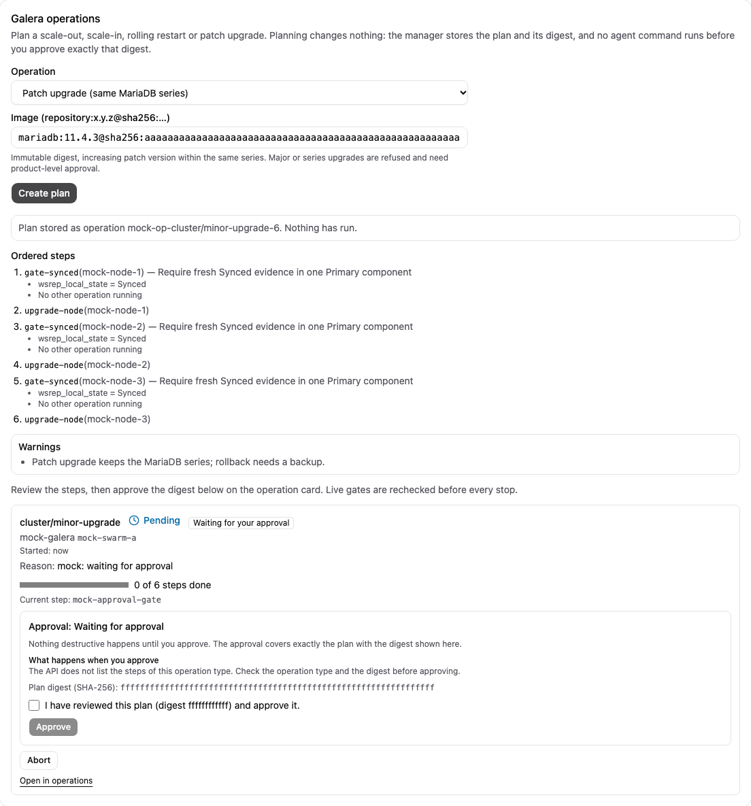
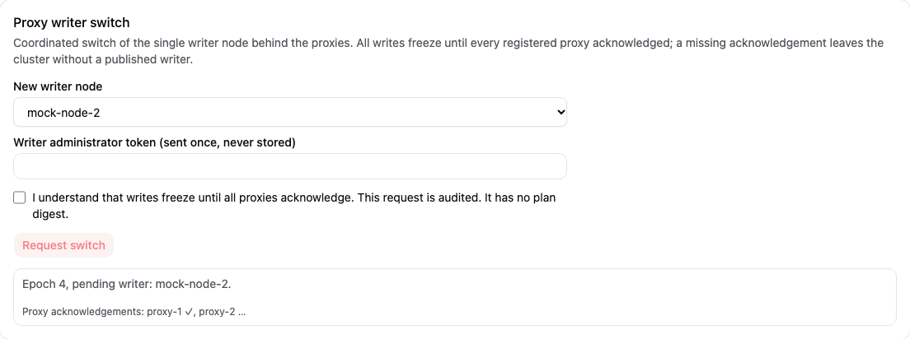

# Operator runbook

[Guide index](index.md) | Previous: [Known limits](10-known-limits.md)

Procedures for whoever runs the manager. Each step states what is verified. Where no product feature exists, the manual fallback is labelled [Untested]: it follows from how the state is stored, but nobody has run a restore from it.

## 1. Back up the manager state

**Product feature [Fakes]:** `POST /api/v1/settings/metastore-backups` (or `manager.backup.metastoreBackupHours`) writes an encrypted export of the metastore for the backup recovery key, and `manager metastore-import` restores it offline; see [Disaster recovery and backup copies](21-disaster-recovery.md). It has never run against a real manager, so the "Fresh install and configuration restore documented and reproduced" R1 gate stays open.

**Manual fallback [Untested]** (managed mode, single instance):

1. Note the paths in your configuration: `manager.dataDir` (metastore, `data.key`, monitoring store) and the configuration file.
2. Stop the manager for a consistent copy (the state is a Raft log plus snapshots in bbolt; do not copy a running instance).
3. Copy `dataDir` and the configuration file to storage outside the host. **`data.key` decrypts accounts, sessions, passkeys and notification secrets: store the copy encrypted and separate from the database backups.**
4. Start the manager and check `GET /api/v1/health`.
5. Also keep: the recovery key secret used for cluster backups, the backend configuration file (S3/SFTP credentials), your recovery codes, and the list of Swarm secrets and networks you created (their names, not the values).

Test the restore on a scratch machine before you need it: copy `dataDir` back with the same `nodeId`, start the manager, log in with a passkey.

## 2. Upgrade the manager

No upgrade has been run since state exists, and no schema migration policy is documented [Untested].

1. Read the release notes and [Known limits](10-known-limits.md). Do the backup in section 1 first.
2. Check the Docker compatibility matrix against your Docker version.
3. Single instance, container: `DBCM_IMAGE=<new> docker compose -f deploy/compose.yaml up -d` (volume kept). Process install: replace the binary and restart the unit. Verify `GET /api/v1/version` and `/api/v1/health`.
4. The agents run the image named in the manager settings. After changing the agent image, run `POST /api/v1/swarms/{id}/agents/deploy` and confirm that every host reports `agentIdentity: true` [Untested].
5. Running operations survive a restart only as far as the runner resumes them (`autoResume`); check `GET /api/v1/operations` and resume or abort pending ones. Do not upgrade during a backup, restore or recovery.
6. Rollback: restore the previous image and the state copy from step 1. Major-version upgrades will need explicit approval once they exist.

Database (MariaDB) upgrades are not implemented; major upgrades always need your explicit approval.

## 3. Lab cleanup (test environments only)

Lab VMs are created and removed only with `bin/lab`, which keeps an ownership manifest (`.lab/manifest.json`) and only touches names starting with `dbcm-lab-`.

```sh
make build
bin/lab status             # read-only: host capacity, budget, manifest, unrelated Lima/Colima entries
bin/lab cleanup            # preview of the manifest-scoped teardown
bin/lab cleanup -apply     # executes it; fails if an unrelated entry disappeared
```

The experiment scripts under `tests/p0/` create and remove their own VMs and run `bin/lab cleanup -apply` in an exit trap [Lab VMs]. Rules: respect the lab budget (16 GB RAM, 50% CPU, about 100 GB disk), never use `docker system prune`, never remove unrelated Colima or Lima profiles, and keep production credentials and backups out of the lab. Reclaimed disk space after cleanup was not verified (the free space was lower afterwards in W04). Host-side build artifacts in the git-ignored `.lab/` directory can be deleted by hand.

## 4. Host maintenance and drift

**Host maintenance** [Fakes]: `GET /api/v1/hosts/{id}/maintenance-plan` previews, per cluster with a node on the host, the steps, warnings and why a cluster refuses (fewer than a strict majority of its nodes outside the host, an unfinished operation). `POST /api/v1/hosts/{id}/maintenance` (optional `reason`) stops those nodes gracefully one at a time, each only after every node of the cluster on other hosts is Synced; replacement on that host is paused. It refuses with 409 and changes nothing if any cluster refuses. `Host.maintenance.ready` says when you may reboot the host yourself: **the product never reboots or drains a host and does not change its Swarm availability.** `DELETE /api/v1/hosts/{id}/maintenance` checks each volume identity marker, starts the nodes one at a time and waits for Synced (IST or SST). Needs operate permission on the host and its clusters; audited.

**Drift** [Fakes]: `GET /api/v1/clusters/{id}/drift` compares the cluster record with the Swarm services carrying its label (missing, recreated outside the manager, foreign labels, changed placement, scaled to 0 or not running outside maintenance and operations, unexpected services). Each finding proposes a manual action; nothing is changed. The leader also checks periodically and records an event when the findings change.

The **Hosts** page offers **Maintenance** per enrolled host: **Show maintenance plan** previews, per cluster, the steps and warnings, or why the cluster refuses (fewer than a strict majority of its nodes would remain). Only a plan without refusals can be started; the manager never reboots or drains the host and says when it is ready. The **cluster detail** page has a **Drift check** card that lists differences between the cluster record and the Swarm services, each with a proposed manual next step; nothing is changed automatically.


*Screenshot from the development mock server (`npm run dev:mock`, invented sample data), not from a real manager.*


*Screenshot from the development mock server (`npm run dev:mock`, invented sample data), not from a real manager.*

Mock-server views only [Mock only].

## 5. Replicas, key ring and peer certificates

Three manager processes with keyring and peer TLS ran on lab VMs (E4 B2) [Lab VMs]. The three-service Swarm stack and the new renewal, forwarding and compaction loops have fake/static evidence only [Fakes]. Reference: [configuration reference](12-configuration-reference.md), [ADR 0013](../../decisions/0013-replica-keys-peer-tls-and-revocation.md).

1. **Peer certificates:** `DBCM_PEER_CA_PASSPHRASE=<at least 12 characters> manager -issue-peer-certs ./peers -installation inst-1 -peer-ids manager-1,manager-2,manager-3`. This writes `ca.pem`, `ca.sealed` (the encrypted CA) and one directory per replica with `peer.pem`, `peer-key.pem` and an atomic renewal bundle `peer-bundle.pem`. Copy only that replica's bundle to its local volume; keep separate offline recovery copies of `ca.sealed` and the passphrase. The command refuses to overwrite an existing CA.
2. **Configuration:** on every replica set `peers` (the same list), `bootstrap: true` for the first start, `keyring: true` and `peerTLS`. With `peerTLS.renew` configured, each replica checks on startup and every 12 hours, renewing 30 days before expiry (365-day default) without restart. The sealed CA and passphrase are online secrets on every node; see [installation](../../INSTALL.md#three-replica-ha-stack-static-checks-and-in-process-tests-only). Without this opt-in, reissue manually before expiry.
3. **First replica:** start it. An existing `data.key` is adopted as the first key of the keyring; no new key file is created.
4. **Register further replicas:** on each, run `manager -print-replica-key -config <file>` (creates `<dataDir>/replica.key` if needed) and note the public key and its fingerprint. Compare them out of band, then as an administrator call `PUT /api/v1/settings/replicas/{id}/data-key-recipient` with the public key (`dbcmpk1:...`). Only current voters are accepted; nothing is registered automatically. A replica that becomes leader without the key hands leadership over, so an unregistered replica will not serve the API. `GET /api/v1/settings/replicas` shows the keyring status and whether the keys are `recoverable`.
5. **Recovery:** with `settings.backup.recipientKey` configured, every data key also has an envelope for the backup recovery key; keep that private key outside the cluster. Back up `<dataDir>` as in section 1.
6. **Cut off a replica:** `POST /api/v1/settings/replicas/{id}/revoke-certificates` denies its manager certificates at every agent. It does not take back keys the replica already unwrapped; rotation and re-encryption now have an administrator-only digest approval flow (see [Security model](08-security-model.md)); cached keys cannot be withdrawn.

**Settings > Manager replicas and keyring** lists each replica with the fingerprint of its registered public identity and whether the current data key is wrapped for it, warns when the key has no backup recovery envelope, registers a data-key recipient (format `dbcmpk1:...`, compare it out of band first) and revokes all manager certificates of a replica after a confirmation. No key material is ever displayed.


*Screenshot from the development mock server (`npm run dev:mock`, invented sample data), not from a real manager.*

Mock-server view only [Mock only].

## 6. Remove a manager installation

`docker compose -f deploy/compose.yaml down` (add `-v` to delete the `manager-data` volume), or `docker stack rm dbcm` and the volume on each node. The manager does not remove agents, database services or volumes it created. Delete clusters through the API first (approval needed, see [Creating a cluster](03-create-cluster.md)); remove the agent service, host directories under the volume base, and the operator networks and secrets by name. Never prune globally.

## 7. Scale and roll a Galera cluster

[Fakes only] `POST /api/v1/clusters/{id}/operation-plan` stores a plan and returns `id`, `approval.digest`, `plan` (including warnings and resulting nodes) and `agentSteps`. It requires **operate** on that cluster. It reserves the cluster until completion or abort; it sends no agent command before approval. Review the response and approve with `POST /api/v1/operations/{id}/approve`, body `{"digest":"<approval.digest>"}`. The digest covers the stored runner definition. Keep the plan response for review; `GET /api/v1/operations/{id}` supplies its status and approval digest. Abort with `POST /api/v1/operations/{id}/abort` before requesting a different plan.

In the web UI the cluster page has a "Galera operations" card with the same four kinds. It validates the slot or image locally, shows the stored plan (steps, warnings) and then embeds the operation card, where the plan digest is displayed and approval needs an explicit confirmation of that digest. Nothing runs before that. The "Proxy writer switch" card on the same page sends `POST /api/v1/proxy-writers/{cluster}/switch`; it needs the separate writer administrator token (kept in memory only, cleared after the request), shows the freeze epoch and proxy acknowledgements, and has no plan digest because the API offers no preview. Screenshots are mock captures with invented data:





Request bodies:

- Add one node: `{"kind":"scale-out","slot":"n4"}`. Use a unique slot and an eligible free enrolled host; a fresh identity and volume are allocated. The donor and the whole component must be Synced before the join.
- Remove one node: `{"kind":"scale-in","slot":"n4"}`. At least three nodes must remain. The service is stopped gracefully and removed after the remaining nodes are Synced; the old volume is retained for inspection. These retained files still need capacity and a separately approved cleanup.
- Rolling restart/maintenance: `{"kind":"rolling-restart"}`. Each node is stopped, the surviving majority is checked, its volume identity is verified, its spec is updated while stopped, and it is started explicitly. The whole component must be Synced before the next stop. Use section 4 for maintenance that pauses while an operator works on a host.
- Minor maintenance update: `{"kind":"minor-upgrade","image":"mariadb:11.4.14@sha256:<64 lowercase hex characters>"}`. Replace the placeholder with the digest of your reviewed image; this is syntax, not an approved release recommendation. Both source and target must have explicit `x.y.z` tags and immutable digests. Only increasing patch releases within the same MariaDB series and repository are supported. A series change (such as 11.4 to 11.8), a major change, a downgrade or an ambiguous tag is refused. Major/series changes need product-level approval and a curated path; approving an operation cannot bypass this refusal.

Every node must have fresh Synced/Primary evidence in the same cluster history before planning; unknown, stale, conflicting or degraded evidence blocks the request. Live quorum and synchronization gates run before each stop and each start. Direct connections can be interrupted; proxies exclude stopped nodes through health checks. There is no automatic downgrade or full-cluster bootstrap. If a gate pauses, inspect health and use `POST /api/v1/operations/{id}/resume` after resolving the cause. Leader changes adopt the stored steps under the new fencing term. Interrupted operations keep their state for inspection; aborting is not rollback, so inspect partial changes before planning further work.

Verification is limited to unit tests, the actual agent executor with an in-memory Docker, and in-process Raft leader changes. No real database, image upgrade, SST, Swarm or infrastructure was contacted for this feature. Supported release paths still need real lab evidence before rollout.
