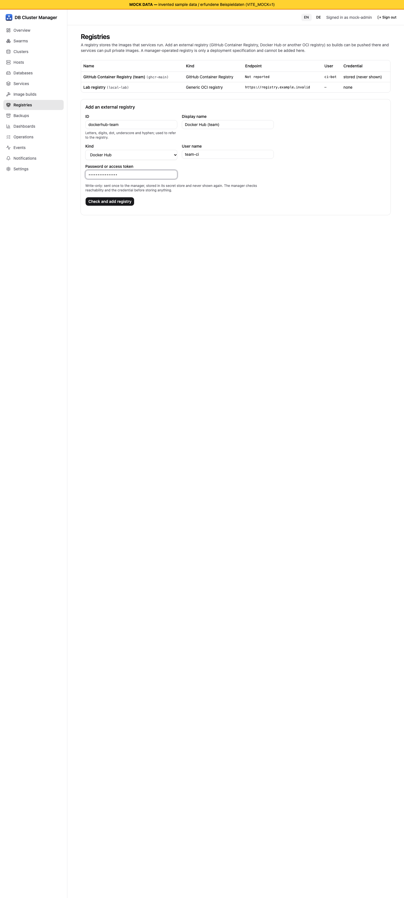

# Image builds and registries (stub)

[Guide index](index.md) | Previous: [Configuration reference](12-configuration-reference.md)

**Status: [Fakes] only.** The backend exists (plan preview, approval digest, build job records, registry client) and was tested against fakes. It is not wired into the manager, its web UI has only run against the mock server, and it has never built or pushed a real image. Do not rely on it.

## What exists

- **Composition:** nginx version, optional PHP-FPM version, PHP extensions and `php.ini` values from allow-lists, structured nginx options, a size-limited custom nginx snippet, extra packages, platforms. The base image must be pinned by digest.
- **Plan before build:** `POST /image-builds` without `approvalDigest` returns the generated Dockerfile, context files, steps, warnings and an explanation. A build starts only with the digest of that plan.
- **Registries:** `POST /registries` registers an external GHCR, Docker Hub or generic registry. The password is stored as a secret and never returned or logged. A manager-operated `registry:2` is only a deploy specification.
- **Records:** each job keeps spec hash, base image digests, image digest, an SBOM placeholder (not generated) and a redacted log.

## Limits

No real build, push, SBOM, vulnerability scan or signature. Alpine package versions are not pinned. Package names and version catalog are unverified. The snippet check is a deny-list, not a parser. See [Known limits](10-known-limits.md) and [STATUS.md](../../STATUS.md).

## In the web UI (mock only)

The **Image builds** page lists recorded builds (status, target image, image digest, SBOM placeholder) and has the web server composer: nginx and PHP version, PHP extensions (only those the catalog offers for the chosen PHP version), `php.ini` values, nginx options, an optional custom snippet, extra packages, platforms and the push target. **Show Dockerfile and plan** displays the generated Dockerfile, the other context files, the steps and warnings, and the plan digest. The build button stays disabled until you tick that you reviewed exactly this plan, and any later edit of the form invalidates the plan. The base image must be given by digest.

*Screenshot from the development mock server (`npm run dev:mock`, invented sample data), not from a real manager.*

The **Registries** page lists registries (never a credential, only whether one is stored) and adds an external GHCR, Docker Hub or generic OCI registry. The password field is write-only: it is sent once and cleared from the page immediately.

*Screenshot from the development mock server (`npm run dev:mock`, invented sample data), not from a real manager.*

Both pages ran only against the mock server [Mock only].
