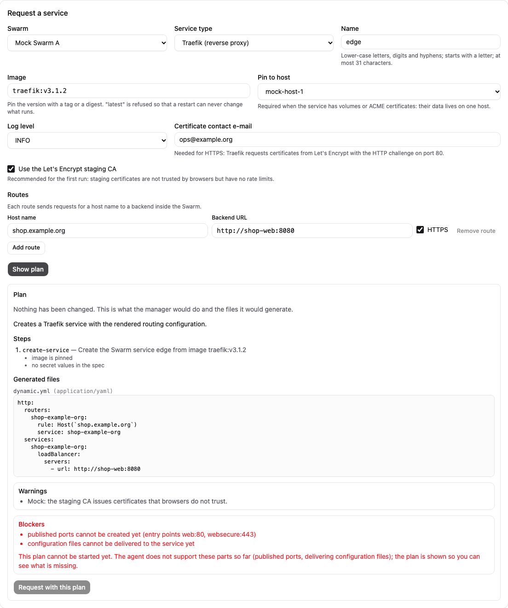

# Services (stub)

[Guide index](index.md) | Previous: [Configuration reference](12-configuration-reference.md)

**Status: [Fakes] only.** The service-type framework (work package W07, requirements X03, X06 and X07 in [KONZEPT.md](../../KONZEPT.md)) exists as code and unit tests. It has never run against a Swarm, Docker or Traefik, and the web UI for it has only run against the mock server. This page is a stub that records what exists, so nobody mistakes it for a usable feature.

## What exists

Two service types, both planned by pure code (`internal/service`) and exposed by the manager API:

- **container**: a generic Docker service with a pinned image, environment, Swarm secrets, networks, managed local volumes, resources, placement and a restart policy.
- **traefik**: a Traefik service with a typed model of entry points, ACME certificate resolvers, routers, services (backends) and middlewares. The manager renders static and dynamic configuration as YAML for review.

Rules the types enforce: images must be pinned (no `latest`); environment variables that look like secrets (`*_PASSWORD`, `*_TOKEN`, ...) are refused and must use a Swarm secret with the `_FILE` convention; volumes are managed local volumes with an identity marker, never host paths, and need a pinned host and one replica. Rendered configuration never contains secret values.

## Flow

1. `POST /api/v1/services/plan` shows the plan (steps, generated artifacts, warnings, blockers) without changing anything.
2. `POST /api/v1/services` stores an operation and waits. Every state-changing step needs an approval bound to the digest of the planned operation.
3. `POST /api/v1/operations/{id}/approve` with that digest lets it run. Approving needs the `create` (or, for a deletion, `delete`) permission on the `service` resource in the Swarm.
4. `DELETE /api/v1/services/{id}` plans the removal the same way; volumes and their data are kept unless `removeVolumes` is set.

Permissions are deny by default. The viewer and operator presets can only read services; the administrator preset can do everything. Every decision is audited.

## Known limits

- **Published ports cannot be created yet**: the agent's service spec has no port field. A plan with a published port is shown with a blocker and cannot be started. This includes the entry points of Traefik.
- **Configuration files cannot be delivered yet**: the agent has no command for it, so the dynamic Traefik configuration (routers, services, middlewares) is only a preview and also blocks the plan.
- No health observation is wired in, no update strategy, no backup of service volumes, and Galera is not a service type (it keeps its own package).
- No CLI, no expert or export view beyond the artifacts in the plan response.

## In the web UI (mock only)

The **Services** page lists managed services and has one form for both types. The three steps are always the same: describe the service, review the plan the manager returns (steps, generated files, warnings, blockers), then approve the operation with the digest it shows. Typing a password into an environment variable is refused: the form tells you to use a Swarm secret instead. A Traefik request is shown with its blockers (published ports and configuration delivery are not supported by the agent yet) and cannot be requested. Deleting a service first shows a deletion plan; the data volumes are kept unless you tick the box.

*Screenshot from the development mock server (`npm run dev:mock`, invented sample data), not from a real manager.*

*Screenshot from the development mock server (`npm run dev:mock`, invented sample data), not from a real manager.*

The UI has only run against the mock server; no service was ever created on a Swarm [Mock only].
