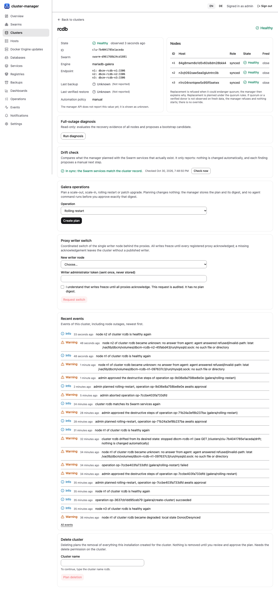
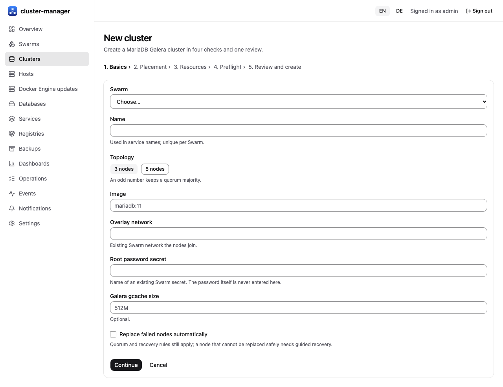
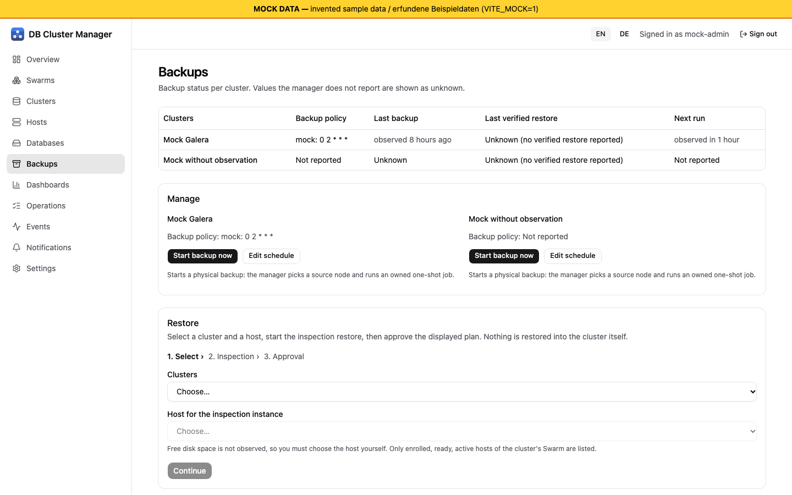
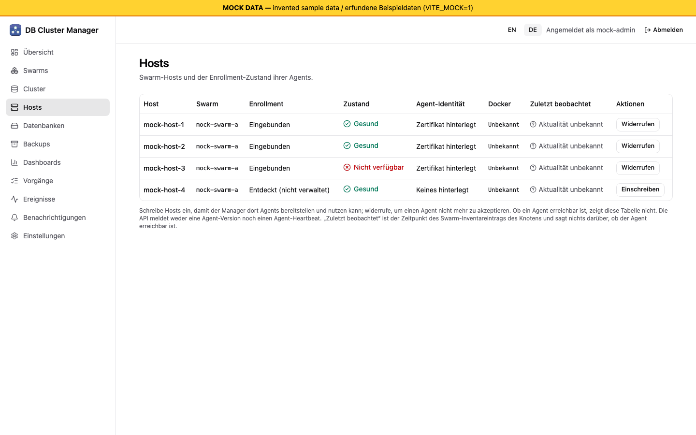
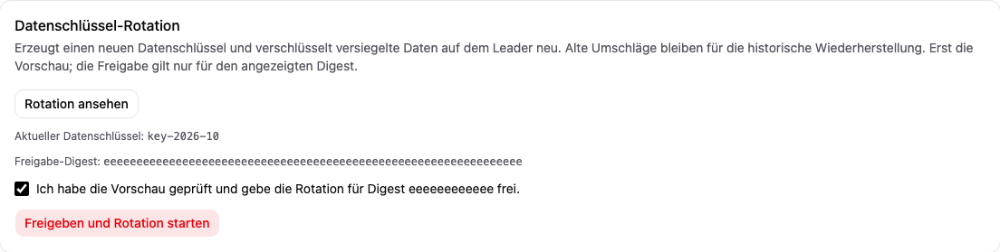

<section class="hero" markdown="1">

{: .logo}

# cluster-manager

A self-hosted, AGPLv3 manager for MariaDB Galera clusters on existing Docker Swarm clusters, with risky actions shown as plans that wait for your approval.

Early implementation · no release yet

[User guides (English)](guides/en/index.md)
[Benutzerhandbuch (Deutsch)](guides/de/index.md)
[Current status](STATUS.md)
[Release policy](RELEASING.md)

Keyboard navigation, focus and narrow-screen behavior are described in the [UI design note](DESIGN.md#static-accessibility-and-narrow-screen-review-2026-10-26) and the bilingual getting-started guides. This review is static; no new browser or screen-reader result is claimed.

*Real screenshot: the UI against a real manager on lab VMs (E13, 2026-10-30, English). Cluster detail, operations, hosts and the wizard are real captures; all other screenshots are from the development mock server (invented sample data) and the German ones are mock.*

</section>

**Nothing has run on a production Swarm and the first Swarm trial has not started.** The manager, agents and MariaDB have run together only on dedicated lab VMs (arm64); many features are verified only with fakes. Each feature below carries its verification level, taken from [STATUS.md](STATUS.md).

## Features and verification

### Galera on Swarm Lab VMs

The manager creates a 3-node MariaDB Galera cluster through its API, using agents it deploys as Swarm services (E4).

### Authenticated agents Lab VMs

Agents enroll with one-time tokens and talk mTLS 1.3 to the manager; revocation and deny-list distribution remain Fakes only.

### Health and node outages Lab VMs

Node loss detected within seconds on the lab. Outage events and notifications exist; their delivery is Fakes.

### Full-outage recovery Lab VMs

Read-only diagnosis of all nodes, optional position recovery, then a guided bootstrap that runs only after a digest-bound approval (E6). The approval needs its own `recover` permission (administrators only) and an outage raises a notification: Fakes.

### Backups and inspection restore Lab VMs

Physical backup to SFTP and an isolated inspection restore with approval (E4). Logical backups, schedules, retention and keyed manifest digests: Fakes.

### SQL proxy Lab VMs

Writer selection, read routing and TLS termination in front of the real cluster as a lab container (E5). Deployment by the manager: Planned.

### Cluster deletion, maintenance, drift Fakes

Deletion as an approved plan, guided host maintenance that never reboots or drains a host, and drift detection that only proposes manual actions.

### Replicated manager Fakes

Raft metastore with peer mTLS and a per-replica data keyring. Three manager processes survived leader kills on lab VMs (E4 B2). Follower API forwarding, automatic peer certificate renewal and deny-list compaction have in-process evidence; the three-service Swarm stack has static checks only.

### Web UI, German and English Mock only

SvelteKit UI with light and dark mode. Checked in a browser only against the development mock server, never against a real manager.

### Beyond Galera Planned

Kubernetes, web and storage servers, Traefik, image builds and Docker engine updates are proposals ([ADR 0012](decisions/0012-broadened-scope-platform.md)). Cluster provisioning has experimental Swarm plan and SSH code plus a flag-gated Kubernetes script preview, tested only with fakes ([guide](guides/en/19-provisioning.md), [ADR 0018](decisions/0018-ssh-cluster-provisioning.md)); no host was contacted. AI-assisted vulnerability response (advisory feeds, patched rebuilds or mitigations, selectable AI providers, notify-only by default, admin approval before any change) is a proposal too ([ADR 0015](decisions/0015-ai-assisted-vulnerability-response.md)); its backend groundwork exists and is tested with fakes only ([guide](guides/en/15-vulnerability-response.md)).

Labels: **Lab VMs** ran with the real manager, agents and MariaDB 11.4 on dedicated Lima VMs, a few times; **Fakes** means unit tests against fakes only; **Mock only** means the UI against invented data; **Planned** is not implemented.

## A look at the UI

All screenshots come from the development mock server with invented sample data (the yellow banner says so). They show the interface, not verified behaviour.

Operations: approval bound to the plan digest, step progress.

Full-outage diagnosis and a recovery plan waiting for approval.

Cluster wizard: basics, placement, resources, preflight, review.

Backups: start, schedule and inspection restore.

Dark mode.

German interface: hosts and agent enrollment.

Galera scale, rolling restart and patch-upgrade planner: the plan is stored first, approval needs the displayed digest (mock capture).

German interface: data-key rotation preview and explicit confirmation (mock capture). Metastore membership and proxy writer switch work the same way.

## User guides

- [User guides (English)](guides/en/index.md): installation, hosts and agents, clusters, health and alerts, backup and restore, node replacement, full-outage recovery, security model, troubleshooting, known limits, operator runbook, [configuration reference](guides/en/12-configuration-reference.md).
- [Benutzerhandbuch (Deutsch)](guides/de/index.md): dieselben Themen auf Deutsch, einschließlich der [Konfigurationsreferenz](guides/de/12-configuration-reference.md).
- Operator CLI: [English](guides/en/20-cli.md) · [Deutsch](guides/de/20-cli.md) (fakes only; existing session cookie required).
- OS patch management (agent-based reports, approval-gated patching, Galera guard): [English](guides/en/23-patch-management.md) · [Deutsch](guides/de/23-patch-management.md) ([ADR 0023](decisions/0023-os-patch-management.md); fakes plus a two-VM lab run; no UI).
- Agent runtimes and capabilities (native vs container agent, routing table, restic on the native agent): [English](guides/en/24-agent-runtimes.md) · [Deutsch](guides/de/24-agent-runtimes.md) ([ADR 0024](decisions/0024-agent-runtimes.md); fakes only; UI badge only).
- Image updates of managed services (Watchtower-style: policies, tag rules, health gate, rollback): [English](guides/en/25-image-updates.md) · [Deutsch](guides/de/25-image-updates.md) ([ADR 0025](decisions/0025-image-update-service.md); fakes only; no UI).
- Image composer (assemble a service image from components: distribution, nginx, PHP with extensions and settings; reviewed Dockerfile preview, variants per distribution): [English](guides/en/26-image-composer.md) · [Deutsch](guides/de/26-image-composer.md) ([ADR 0026](decisions/0026-image-composer.md); fakes and mock server only; catalog unverified, no image built yet).
- Fresh-server bootstrap (onboard a new Linux server: OS check, preflight, hardening, Docker from the pinned repository, agents, Swarm, restic and patch capabilities, host-key pinning, separate lockdown approval): [English](guides/en/27-fresh-server-bootstrap.md) · [Deutsch](guides/de/27-fresh-server-bootstrap.md) ([ADR 0027](decisions/0027-fresh-server-bootstrap.md); simulated host only, nothing ran against a real host).
- Optional modules (switch patch management, host backups, image build/composer/updates, vulnerability response, bootstrap, provisioning, Kubernetes and backup copies at runtime; data is never deleted): [English](guides/en/28-modules.md) · [Deutsch](guides/de/28-modules.md) ([ADR 0030](decisions/0030-optional-modules.md); fakes only).
- Docker Engine update plans: [English guide](guides/en/18-docker-engine-updates.md) · [Deutsche Anleitung](guides/de/18-docker-engine-updates.md) (fakes and mock only; no package source in the shipping manager).

## Project documentation

- [Current status](STATUS.md)
- [Confirmed product requirements](KONZEPT.md)
- [Architecture and feasibility questions](ARCHITEKTUR.md)
- [UI and user experience](DESIGN.md)
- [Decisions and remaining questions](ENTSCHEIDUNGEN.md)
- [Proposed release plan and acceptance gates](RELEASES.md)
- [Local test environment](TESTING.md)
- [Development, documentation and Claude Code handover](ENTWICKLUNG.md)
- [Claude Code bootstrap](handoffs/CLAUDE-START.md)
- [Execution workplan](WORKPLAN.md)
- [Installation and packaging](INSTALL.md)
- [Go and monorepo decision](decisions/0002-go-monorepo.md)
- [Decision records](decisions/0001-product-direction.md)
- [Broadened scope decision](decisions/0012-broadened-scope-platform.md)
- [Replica keys, peer TLS and revocation](decisions/0013-replica-keys-peer-tls-and-revocation.md)
- [Manager container Docker access](decisions/0014-manager-container-docker-access.md)
- [AI-assisted vulnerability response (proposed)](decisions/0015-ai-assisted-vulnerability-response.md)
- [Technical references](QUELLEN.md)

Requirements reflect the user's answers through 2026-10-18 and the scope extension of 2026-10-22 ([scope extension requirements](KONZEPT.md#scope-extension)). Release assignments and implementation details remain proposals unless identified as confirmed. Technical documentation is English; the user guides exist in German and English.
